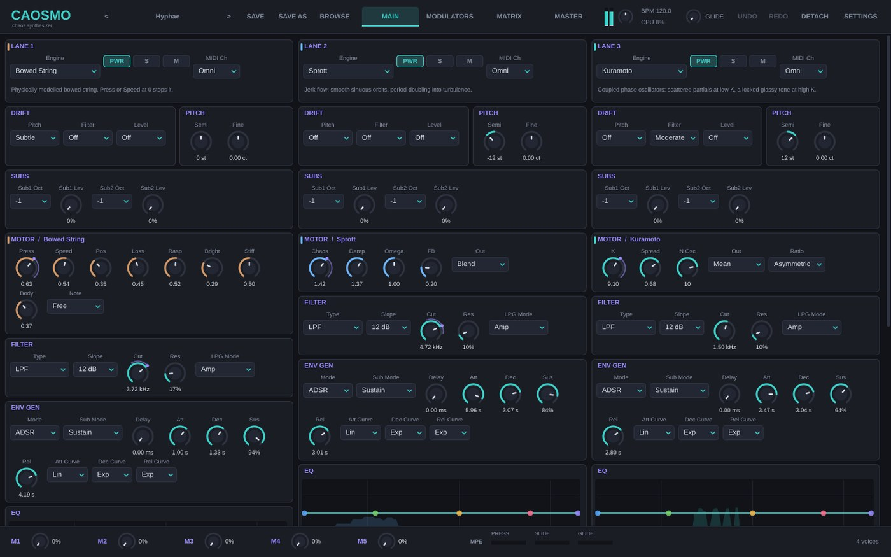
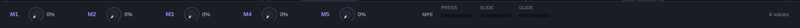
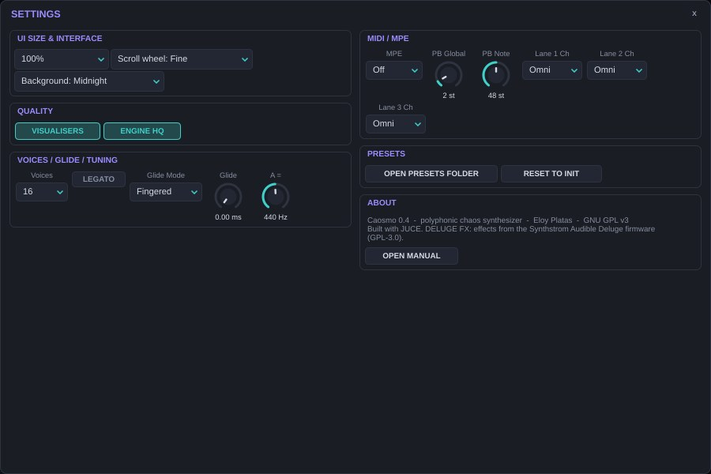
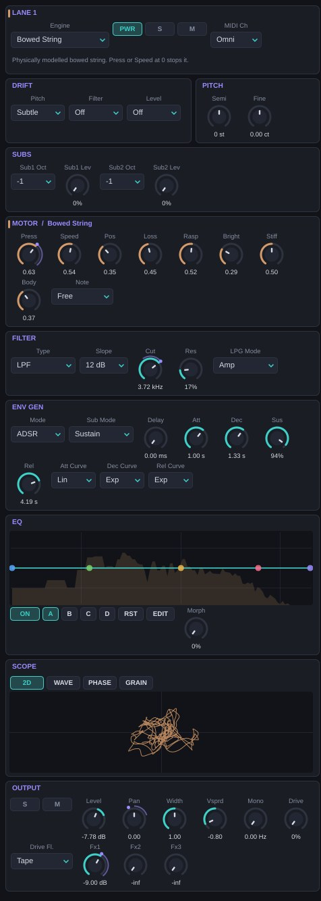

# Introduction {#intro}

Caosmo is a polyphonic synthesizer that plays no fixed waveforms and no samples. Each note starts a **dynamical system**, and what you hear is that system's trajectory, solved sample by sample. Oscillators that synchronise with each other, non-linear springs pushed to their limit, strange attractors, iterated maps, a chaotic electronic circuit, a chemical reaction on a ring of cells, a bowed string, a delay loop with memory and a map that meshes frequencies like the teeth of a gear.

The result is an instrument that behaves more like a physical object than an oscillator. It has calm regions and turbulent regions, it responds differently depending on how you arrive at a setting, and it never sounds exactly the same twice.

## What it offers {#intro-que}

| Block | Contents |
| --- | --- |
| Voices | Up to 64 voices. Each note plays through **3 independent lanes**. |
| Engines | **17 chaotic and stochastic systems**, plus *None* to switch a lane off. |
| Per lane | 2 sub-oscillators, analogue drift, a 14-type filter, an envelope with 4 modes (ADSR, Vactrol, LFO, VENV), a 5-band EQ with 4 snapshots and morph, drive with 5 flavours, 3 sends. |
| Modulation | 8 linkable LFOs, 4 drawable envelopes (VENV), 4 attractors of 12 types, 4 random trigger generators, 10 distributions (one drawable), a 24-route matrix, a drawable keytrack, 5 macros, MIDI learn and MPE. |
| Master | EQ with analyser, saturator, compressor with sidechain, width and a true-peak limiter. |
| Effects | 3 buses with 3 slots (12 effect types, 4 of them spectral) and the **DELUGE FX** rack with the effects from the open-source Synthstrom Audible Deluge firmware. |
| Presets | 288 factory presets in 20 categories, with tags, favourites and search. |
| Formats | VST3 and a standalone application for Linux, Windows and macOS (universal). |

## Origin {#intro-origen}

Caosmo is a functional reimplementation of the concept described in the public documentation of **Fragua** by Pura Belia: a three-lane-per-note chaos synthesizer with twelve engines. All the code, names, interface, presets and this manual are original; it contains no code or assets from Fragua. It is an independent work with no connection to Pura Belia.

## What's new in version 0.5 {#intro-novedades}

Everything new comes from studying the SuperCollider documentation for chaos and randomness generators:

- Five new engines: **Gendy** (Xenakis), **Maps** (ten chaotic maps), **Ecosystems** (neurons, chemical clocks, predators and prey), **Noise** and **Membrane** (a ball bouncing on a modal body).
- Logistic/Henon can iterate in time with the note and play in tune.
- Four random **trigger generators** (Dust, Gauss, Coin, Lorenz, Clock) with direct actions.
- Ten probability **distributions**, one of them drawable, for LFOs, triggers and Note Random.
- LFO waves with memory: Brownian, Geo Brownian, Noise Ring and Markov.
- **Friction** and **Spring** filters, seven new attractor types and six effects: Diffuse, Mag Noise, Rand Comb, Noise Synth, Wave Loss and Squiz.
- 32 new presets in three categories: Stochastic, Neurons & Maps and Bouncing Bodies.

Nothing breaks: 0.4 presets and projects sound the same.

## What's new in version 0.4 {#intro-novedades-04}

- **DELUGE FX** rack with Mod FX, EQ, destruction, delay, three reverbs, compressor and stutter from the Deluge firmware.
- Caosmo is now distributed under the **GNU GPL v3**.
- **Windows and macOS** binaries as well as Linux, built and validated automatically.
- Constant 1.5 ms latency (the DAW no longer sees jumps when the limiter is switched).
- Fix: the Deluge Mod FX could crash the plugin when Depth was raised from 0.

## Requirements {#intro-req}

- A **VST3** host (REAPER, Bitwig, Ableton Live, Cubase, Studio One, Ardour…) or the standalone version. Logic Pro does not load VST3: on a Mac, use another DAW or the standalone app.
- Linux x86-64 (glibc 2.35 or later, e.g. Ubuntu 22.04), 64-bit Windows 10/11, or macOS 10.15 or later (Intel or Apple Silicon).
- A modern CPU: every lane solves differential equations per sample. Read the performance chapter before asking for 64 voices on three lanes.

# Installation {#instalacion}

Each package contains the `Caosmo.vst3` plugin, the standalone version, the licence and the manual. The 288 presets are built into the plugin: there is nothing else to copy.

| System | Copy `Caosmo.vst3` to | Standalone |
| --- | --- | --- |
| Linux | `~/.vst3/` (your user only) or `/usr/lib/vst3/` (system-wide) | `Caosmo-standalone` |
| Windows | `C:\Program Files\Common Files\VST3\` | `Caosmo.exe` |
| macOS | `~/Library/Audio/Plug-Ins/VST3/` or `/Library/Audio/Plug-Ins/VST3/` | `Caosmo.app` |

Then rescan plugins in your DAW. In REAPER: *Options → Preferences → Plug-ins → VST → Re-scan*. Caosmo appears as an instrument by the manufacturer **Eloy Platas**.

## macOS and Gatekeeper {#inst-mac}

The binary is universal and carries an *ad hoc* signature, not an Apple developer certificate. If macOS says the plugin "is damaged" or "can't be opened", remove the quarantine flag from Terminal:

```
xattr -dr com.apple.quarantine ~/Library/Audio/Plug-Ins/VST3/Caosmo.vst3
xattr -dr com.apple.quarantine /Applications/Caosmo.app
```

## Windows {#inst-win}

Copying to `Common Files\VST3` needs administrator rights. If your DAW does not find the plugin, check that this folder is in its list of VST3 paths. The standalone version opens *Options → Audio/MIDI Settings* to choose a device; ASIO gives the lowest latency.

## User files {#inst-archivos}

| What | Where |
| --- | --- |
| User presets (`.caosmo`) | `Documents/Caosmo Presets/User` |
| User VENV shapes | `Documents/Caosmo Presets/VENV` |
| Favourites and interface preferences | Application settings (per user) |

"Documents" is `~/Documents` on Linux and macOS and the Documents folder of your profile on Windows. Presets are XML text files: you can share them and keep them under version control.

## Building from source {#inst-compilar}

Caosmo is free software (GPL v3). To build it you need CMake 3.22+, a C++23 compiler (GCC 13, Clang 16, AppleClang 15 or Visual Studio 2022's clang-cl) and JUCE 8.0.4:

```
git clone https://github.com/eloyplatas/CAOSMO-VST-linux-osx-windows.git caosmo
git clone --depth 1 --branch 8.0.4 https://github.com/juce-framework/JUCE.git JUCE
cd caosmo
cmake -B build -DCMAKE_BUILD_TYPE=Release -DCAOSMO_TESTS=OFF
cmake --build build --config Release
```

On Windows add `-A x64 -T ClangCL` to the first `cmake` call: the Deluge code uses GCC/Clang extensions that MSVC does not accept. On Linux you need the ALSA, X11, Freetype and fontconfig development headers. The repository builds all three platforms on GitHub Actions on every change and leaves the packages on the `builds` branch.

# Chaos for musicians {#caos}

You don't need maths to play Caosmo, but five ideas will save you a lot of time.

## Dynamical systems {#caos-sistemas}

A dynamical system is a set of variables (position, velocity, temperature, phase…) and a rule saying how they change over time. A sine oscillator is the most boring dynamical system possible: it goes round in a circle forever. Caosmo's engines are systems with **non-linearities**: cubic terms, absolute values, saturation, products between variables. Those non-linearities are what make complex behaviour possible.

## Attractors {#caos-atractores}

Let a system with friction run, and its state ends up in a particular region: the **attractor**. It can be a point (the system stops: silence), a cycle (the system repeats a shape: a periodic tone), a torus (two superimposed cycles: a tone with beating) or a **strange attractor** (the system never repeats yet never escapes: a living, rough or noisy sound). The SCOPE's phase portraits literally show each lane's attractor.

## Sensitivity to initial conditions {#caos-sensibilidad}

In a chaotic system, two almost identical states drift apart exponentially. That's why Caosmo starts each note with a **different seed**: two identical notes in a row are not identical, and a chord does not sound like transposed copies. If you want repeatability, several engines have a **Note → Free** menu that keeps the state between notes instead of resetting it.

## Bifurcations {#caos-bifurcaciones}

As you move a control parameter (K, Gamma, Chaos, Alpha, Sharp, R…) the kind of attractor can change suddenly: a tone splits into its sub-octave (*period doubling*), a beating appears, or the sound breaks into noise. Those points are **bifurcations**. They are the instrument's best material: modulate slowly around them with a VENV or an LFO and you will hear the system make up its mind. Many boundaries have **hysteresis**: the point where the system breaks on the way up is not where it recovers on the way down.

## Synchronisation and locking {#caos-sincronizacion}

Several engines (Kuramoto, Circle Map, Mackey-Glass) try to **lock**: oscillators that end up beating together, frequencies that get trapped in simple ratios (1:1, 2:3, 3:4). Between the locking zones there are quasi-periodic and chaotic regions. That's where those engines get their metallic, vocal or trembling character.

## How Caosmo protects the system {#caos-proteccion}

A non-linear system can run off to infinity. Every engine watches its state: if a variable blows up or stops being a valid number, the engine quietly restarts from a safe position. At worst you hear a small click, never a burst of level. All pitched engines also limit their integration step so they stay stable on high notes.

# Architecture and signal flow {#arquitectura}

<div class="figure">SIGNALFLOW</div>

Every note you play takes a **voice**. Inside the voice, each lane that has an engine has its own complete chain:

1. **Engine**: produces the signal by solving its system, tuned to the note if it is a pitched engine.
2. **Sub 1** (another instance of the same engine, 1–3 octaves down) and **Sub 2** (a sine 1–2 octaves down) are added to the engine.
3. **Filter** with 14 types.
4. **Envelope** (VCA, and in LPG mode the filter too), scaled by velocity.

The voices of each lane are then summed on the **lane bus**, where **EQ**, **drive**, **width**, **bass mono**, **pan**, **level** and the **sends** to FX buses A–C are applied. The lane buses and the FX returns are summed and pass through the **DELUGE FX** rack (if enabled) and the **master chain**.

This split matters for modulation: whatever happens inside the voice (pitch, filter, engine, envelope, level) can be modulated **per note**; whatever happens on the lane bus (EQ, drive, width, pan, sends) can only be modulated by **global sources**, because separate notes no longer exist there.

## Voices and voice stealing {#arq-voces}

**Voices** sets the maximum polyphony (1, 4, 8, 16, 32 or 64). When they run out, Caosmo first takes a free voice, then the oldest released voice, and as a last resort the oldest sounding voice. With **Voices = 1** the synth is monophonic: with **Legato** on, tied notes do not retrigger the envelopes, and **Glide** slides the pitch (*Fingered*: only on tied notes; *Always*: always).

## Per-note seed {#arq-semilla}

Each note gets its own random number, used by the engines for their initial state, by drift, by the *Note Random* source and by the stereo placement of Voice Spread. That's why a preset feels alive even without modulation.

# The interface {#interfaz}

The window is 1440 × 900 points at 100 % and can be scaled from 75 to 200 % in *Settings*. Long pages scroll with the wheel or the side bar.



## Top bar {#ui-barra}


- **< preset name >**: click the name to open the browser; the arrows load the previous and next preset in the filtered list.
- **SAVE / SAVE AS / BROWSE**: save over the current user preset, save as a new one, and open the browser.
- **MAIN, MODULATORS, MATRIX, MASTER**: the four pages.
- **Meter, output level, BPM and CPU**: output level, Output Gain, host tempo and audio engine load.
- **GLIDE**: portamento time.
- **UNDO / REDO**.
- **DETACH**: opens the current page in a floating window, handy with two screens.
- **SETTINGS**: settings, presets and credits.

## Bottom bar {#ui-inferior}



The **macros M1–M5**, the **MPE** meters of the latest note (PRESS, SLIDE, GLIDE) and the number of sounding voices.

## The four pages {#ui-paginas}

| Page | Contents |
| --- | --- |
| MAIN | The three lanes in columns: LANE, DRIFT, PITCH, SUBS, MOTOR, FILTER, ENV GEN, EQ, SCOPE and OUTPUT. |
| MODULATORS | 8 LFOs, 4 VENVs with their editor and 4 attractors with their 3-D portrait. |
| MATRIX | The 24 routes, the KEYTRACK editor and the MACROS view. |
| MASTER | Tabs CHAIN (master chain and meters), FX (buses A–C) and DELUGE (the Deluge rack). |

## Working with controls {#ui-controles}

- **Drag** to change a value; **Shift + drag** for fine adjustment.
- **Double-click** opens numeric entry.
- **Mouse wheel**: adjusts according to *Settings* (Fine, Coarse or Off, so scrolling never moves anything).
- **Right-click**: the control's menu with *Modulate with…* (pick a source and create the route), *Send to Macro*, *Connected* (lists and deletes the routes that reach the control), *MIDI / MPE → MIDI Learn*, default value and numeric entry.
- **Modulation halo**: the violet arc around a control shows the range its routes cover; the bright dot is the modulated value right now (of the latest note for per-note destinations).

## Container menus {#ui-contenedor}

The title of each block (FILTER, ENV GEN, LFO 3…) is a menu:

- **Copy / Paste**: copies the block's settings; *Paste with routes* includes the modulation routes that reach it.
- **Vary**: moves each value randomly by up to ±15 %. Perfect for variations on a sound that already works.
- **Randomise**: completely random values within useful ranges.
- **Copy to Lane** (LANE only): copies the whole lane to another lane.

## Undo {#ui-deshacer}

Ctrl + Z / Ctrl + Shift + Z (Cmd on Mac) undo and redo changes to parameters, routes, VENV shapes and the keytrack.

## Settings {#ui-settings}



| Section | Setting | What it does |
| --- | --- | --- |
| UI Size & Interface | Size | 75–200 % interface scale. |
| | Scroll wheel | Fine, Coarse or Off (so scrolling never moves controls). |
| | Background | Midnight or Graphite. |
| Quality | VISUALISERS | Runs or pauses scopes and visualisers (saves UI CPU). |
| | ENGINE HQ | ×2 oversampling in the engines that use it (Lorenz Additive). |
| Voices / Glide / Tuning | Voices, Legato, Glide Mode, Glide, A = | Polyphony, legato, portamento and reference tuning (415–466 Hz). |
| MIDI / MPE | MPE, PB Global, PB Note | MPE mode and global and per-note pitch-bend ranges. |
| | Lane 1–3 Ch | MIDI channel of each lane (same setting as in LANE). |
| Presets | OPEN PRESETS FOLDER | Opens the preset folder in your file manager. |
| | RESET TO INIT | Replaces the patch with the initial one. |
| About | OPEN MANUAL | Version, licence and this manual. |

Interface preferences (size, wheel, background, visualisers) belong to you and are not stored in presets.

# The lanes {#capas}



Caosmo has three identical lanes (L1, L2, L3). Each note plays through every lane that has an engine and is powered. Use them as three stacked synths, as one sound and its sub-layers, or split them by MIDI channel for a keyboard split or a simple multitimbral setup.

## LANE {#capas-lane}

| Parameter | Range (default) | What it does |
| --- | --- | --- |
| Engine | None + 17 engines (L1 Kuramoto, L2 and L3 None) | The lane's engine. The settings of all 17 engines are kept: you can switch engines and come back without losing anything. |
| PWR | On/Off (On) | Switches the lane off: it stops being computed and its envelope stops modulating. |
| S / M | Solo / Mute | Isolate or silence the lane while it keeps running (its sources keep modulating). |
| MIDI Ch | Omni, 1–16 (Omni) | Channel that triggers the lane. Ignored when MPE is on. |

## DRIFT {#capas-drift}

Every note gets a fixed random deviation when it starts, like the tolerances of an analogue synth. It does not change during the note.

| Level | Pitch | Filter | Level |
| --- | --- | --- | --- |
| Off | 0 | 0 | 0 |
| Subtle | ±3 cents | ±1 semitone | ±0.5 dB |
| Moderate | ±8 cents | ±3 semitones | ±1.5 dB |
| Heavy | ±20 cents | ±7 semitones | ±3 dB |

*Subtle* on all three lanes thickens a chord without detuning it; *Heavy* on pitch gives the detuned chorus of an old tape.

## PITCH {#capas-pitch}

**Pitch** transposes ±36 semitones and **Fine** ±100 cents. Both are per-note modulation destinations: a slow LFO on Fine gives vibrato; a VENV on Pitch, pitch sweeps. On unpitched engines (Lorenz+Rossler, Logistic/Henon, Gray-Scott without BPF) Pitch only affects the sub-oscillators and any filters that follow the note.

## SUBS {#capas-subs}

| Parameter | Range (default) | What it does |
| --- | --- | --- |
| Sub1 Oct | −1, −2, −3 oct (−1) | Octave of Sub 1. |
| Sub1 Lev | 0–100 % (0) | **A second instance of the same engine**, with the same settings, playing 1–3 octaves down. Adds weight without losing character. Doubles the engine's CPU cost. |
| Sub2 Oct | −1, −2 oct (−1) | Octave of Sub 2. |
| Sub2 Lev | 0–100 % (0) | A **pure sine** with a stereo detune of about ±3 cents. Gives a fundamental to noisy or unpitched engines. Almost free. |

Both subs go through the same filter and envelope as the engine.
