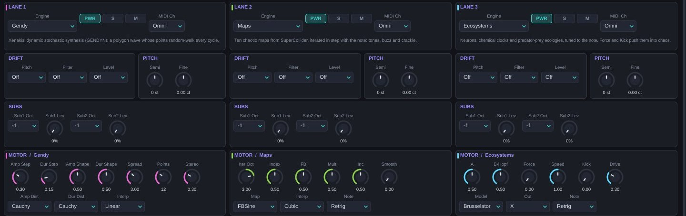
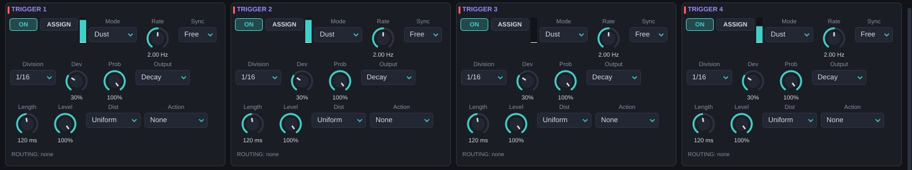
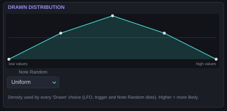

# The SuperCollider engines {#motores-sc}

Version 0.5 adds five engines (13–17) that come from studying the documentation of **SuperCollider**, the open-source synthesis language. They are reimplementations of its chaos and randomness generators (UGens), adapted to Caosmo's architecture: each one follows the note, gets its per-note seed and exposes its first six parameters as the matrix destinations *Motor 1–6*.

| # | Engine | Pitched | Character | CPU |
| --- | --- | --- | --- | --- |
| 13 | Gendy | Yes | Xenakis' stochastic synthesis: timbres that rewrite themselves every cycle | Low |
| 14 | Maps | Yes | Ten SuperCollider chaotic maps iterated in time with the note | Very low |
| 15 | Ecosystems | Yes | Neurons, chemical clocks and predator-prey populations | Low |
| 16 | Noise | No (yes with Key BPF) | Classic and chaotic noise: pink, brown, gray, Crackle, Dust | Very low |
| 17 | Membrane | Yes | A ball bouncing on a membrane, bar or bell | Medium |

With 8 notes on three lanes, each of these engines uses 5 to 13 % of one core.

## Gendy {#m-gendy}

**The system.** **Iannis Xenakis'** *dynamic stochastic synthesis* (GENDYN), in Nick Collins' Gendy1 version. The wave is a polygon of N points. Every cycle, each point takes a random step in amplitude and in duration, with a size drawn from a probability distribution. Barriers reflect the steps so the polygon cannot run away. The result has a recognisable pitch but a timbre that never repeats.

**In Caosmo.** The polygon's total duration is tuned to the note; *Spread* lets each segment stray a few semitones. Two independent generators feed the left and right channels.

| Parameter | Range (default) | What it does |
| --- | --- | --- |
| Amp Step | 0–1 (0.3) | Size of the amplitude steps. Low: almost static. High: rough noise. |
| Dur Step | 0–1 (0.15) | Size of the duration steps: how much the cycle wobbles and detunes. |
| Amp Shape | 0–1 (0.5) | Parameter of the amplitude distribution (the shape of the bell, of the tail…). |
| Dur Shape | 0–1 (0.5) | The same for the duration distribution. |
| Spread | 0–24 st (3) | Maximum deviation of each segment from the note. |
| Points | 2–32 (12) | Polygon points. Few: harsh, bright tones. Many: finer timbres. |
| Stereo | 0–1 (0.3) | Difference between the two generators: 0 mono, 1 two different voices. |
| Amp Dist / Dur Dist | Linear, Cauchy, Logist, Hyperbcos, Arcsine, Expon, Sinus (Cauchy) | Step distribution. Cauchy has long tails: small steps almost always and a huge one now and then. *Sinus* takes its steps from an internal sine. |
| Interp | Linear, Cubic (Linear) | How the points are joined. Cubic rounds the corners. |

**Sweet spots.** Amp Step 0.1–0.2 with Dur Step 0.05: a breathing choir (*Xenakis Choir*). Points 6 with both steps above 0.5: the rough sound of *S709*. *Hyperbcos* is quieter than the other distributions: make up with Level.

## Maps {#m-mapszoo}

**The system.** SuperCollider's *ChaosGen* family: ten iterated maps, each a rule that computes the next value from the current one.

**In Caosmo.** The map is iterated at the note frequency times 2^Iter Oct. Between iterations the output is held (Step), interpolated in a straight line (Linear) or along a Catmull-Rom curve (Cubic): SuperCollider's N, L and C suffixes. With a low Iter Oct you hear each iteration as part of the waveform; with a high Iter Oct the map makes a high timbre over the note. Parameters A–D change meaning with the map; the labels in the interface update themselves. With A–D at 50 % every map uses SuperCollider's default values.

| Map | A | B | C | D | Character |
| --- | --- | --- | --- | --- | --- |
| Latoocarfian | a | b | c | d | From Pickover's book: tones, cycles or chaos depending on the four parameters. |
| Standard | K | — | — | — | Chirikov's map. K below 1: near-periodic hum. Above: it tears. |
| Gingerbread | X0 | Y0 | — | — | The Gingerbreadman: only the initial conditions matter; moving them restarts the map. |
| Cusp | a | b | — | — | Sharp peaks, a reedy timbre. |
| Quad | a | b | c | — | General quadratic map. |
| LinCong | Mult | Inc | Mod | — | Linear congruential generator: 8-bit digital staircases. |
| FBSine | Index | FB | Mult | Inc | A sine whose phase is advanced by a congruential map. Index 0.5, FB 0 and Mult 0.25 give a pure sine. |
| Crackle | Param | — | — | — | The Crackle map: crackling near collapse. |
| Logistic | R | — | — | — | The logistic map, pitched. |
| Henon | A | B | — | — | The Hénon map, pitched. |

| Parameter | Range (default) | What it does |
| --- | --- | --- |
| Iter Oct | −2 – 7 (3) | Iterations per note cycle, in octaves: 3 = 8 iterations per cycle. |
| A, B, C, D | 0–1 (0.5) | Map parameters (see table). |
| Smooth | 0–1 (0) | Low-pass with level compensation. |
| Map | The 10 maps (Latoocarfian) | System. |
| Interp | Step, Linear, Cubic (Cubic) | Interpolation between iterations. |
| Note | Retrig, Free (Retrig) | Retrig restarts the map on every note; Free lets it run on. |

**Logistic/Henon now follows the note too.** Engine 5 has a new parameter, *Clock*. *Per Sample* is the old behaviour (one iteration per sample, unpitched noise). *Note Step*, *Note Linear* and *Note Cubic* iterate it like Maps, at the note times 2^*Iter Oct*: the grainy noise becomes a tuned tone.

## Ecosystems {#m-eco}

**The system.** Six models from biology and chemistry, taken from Nick Collins' SLUGens and Till Bovermann's ChaosUGens:

- **FitzHugh-Nagumo**: a simplified neuron. Below a current threshold it does nothing; above it, it fires regular spikes.
- **Brusselator**: a theoretical chemical clock. Past the Hopf bifurcation it oscillates on a limit cycle.
- **Oregonator**: the model of the Belousov-Zhabotinsky reaction, the famous chemical cocktail that changes colour in cycles.
- **Lotka-Volterra**: prey and predators. When prey are plentiful the predators grow, then eat them.
- **Arneodo-Coullet-Tresser**: three competing species; it has a chaotic attractor.
- **Spruce Budworm**: outbreaks of a forest pest, iterated as a map.

**In Caosmo.** The equations are integrated with 4th-order Runge-Kutta. A period detector measures the oscillation and adjusts the speed so it sounds at the note's pitch, even when P1 and P2 change the system's natural period. *Force* adds sinusoidal forcing at the note and *Kick* adds noise hits: both push the system off its cycle towards chaos.

| Model | P1 | P2 |
| --- | --- | --- |
| FitzHugh-Nagumo | Current: input current | Eps: recovery speed |
| Brusselator | A | B-Hopf: distance to the bifurcation |
| Oregonator | F: stoichiometry | Eps: time-scale separation |
| Lotka-Volterra | Prey: prey growth | Pred: predator death |
| Arneodo-Coullet-Tresser | Alpha | Immig: immigration |
| Spruce Budworm | Step: map step | K1: forest capacity |

| Parameter | Range (default) | What it does |
| --- | --- | --- |
| P1, P2 | 0–1 (0.5) | Model parameters (see table). The labels change with the model. |
| Force | 0–1 (0) | Periodic forcing at the note frequency. |
| Speed | 0.25–4 (1) | Multiplies the speed: changes the timbre without changing the pitch it tunes to. |
| Kick | 0–1 (0) | Noise impulses that knock the system off its orbit. |
| Drive | 0–1 (0.3) | Output saturation. |
| Model | The 6 models (FitzHugh-Nagumo) | System. |
| Out | X, Y, Z, Blend (X) | Variable you hear (Z only exists in ACT). |
| Note | Retrig, Free (Retrig) | Retrig restarts the system on every note; Free lets it run on. |

**Sweet spots.** FitzHugh-Nagumo with P1 near the centre and a little Kick: a neuron that sometimes misfires (*Spiking Neuron*). At the extremes of P1 the neuron rests and the lane goes silent: raise Kick to wake it. Brusselator with Force 0.35: in and out of its cycle (*Brusselator Pad*).

## Noise {#m-noise}

**The system.** SuperCollider's noise generators: WhiteNoise, PinkNoise (Voss-McCartney algorithm), BrownNoise, GrayNoise (one bit of a register flipping at random), ClipNoise, Crackle and the Dust and Dust2 impulses.

| Parameter | Range (default) | What it does |
| --- | --- | --- |
| Tone | −1 – 1 (0) | Spectral tilt: dark to bright. |
| Density | 1–20 000 /s (300) | Impulses per second for Dust and Dust2. |
| Chaos | 1–2.05 (1.9) | Crackle's parameter. Near 2 it crackles; above, it breaks into bursts. |
| Stereo | 0–1 (0.6) | Decorrelation between channels. |
| Key BPF | 0–1 (0) | Mix of a band-pass tuned to the note: gives the noise a pitch. |
| Q | 0.5–30 (6) | Band-pass resonance. |
| Type | White, Pink, Brown, Gray, Clip, Crackle, Dust, Dust2 (White) | Generator. |
| Clock | Free, Note Step, Note Smooth (Free) | *Note Step*: sample-and-hold at twice the note (tuned "digital" noise). *Note Smooth*: the same, interpolated. |

**Sweet spots.** Dust2 with Key BPF 0.8 and Q 18: tuned rain (*Dust Devils*). Gray with Note Step and Q 25: a bit-flip lead (*Gray Code*).

## Membrane {#m-membrane}

**The system.** A falling, bouncing ball, like Dan Stowell's TBall UGen, striking a modal resonant body. Each hit excites up to 16 modes with the ratios of a circular membrane, a square plate, a free bar or a bell.

**In Caosmo.** When you play the note the ball drops from *Height*. Each bounce loses energy (*Bounce Loss*) and lands sooner, so the hits speed up until the ball comes to rest: a roll that closes on its own. A new note strikes the same body, which keeps ringing.

| Parameter | Range (default) | What it does |
| --- | --- | --- |
| Gravity | 0.5–40 (6) | Gravity. High: fast bounces. Low: slow, spaced hits. |
| Bounce Loss | 0–1 (0.35) | Energy lost per bounce: how long the roll lasts. |
| Height | 0–1 (0.5) | Initial height: strength of the first hit and time until it. |
| Scatter | 0–1 (0.1) | Irregularity of each bounce. |
| Decay | 0.02–8 s (0.8) | Decay of the modes. |
| Strike | 0–1 (0.5) | Brightness of the hit: low excites the low modes; high, the upper ones. |
| Tension | 0–1 (0) | Stretches the mode ratios: more inharmonic, tighter bodies. |
| Modes | 2–16 (10) | Number of modes. |
| Body | Circle Membrane, Square Membrane, Free Bar, Bell (Circle Membrane) | Body. |

**Sweet spots.** Free Bar with gravity 14: a marble on a xylophone (*Marble Bar*). Bell with gravity 1.2 and a long Decay: moon strikes (*Low Gravity*). A random trigger routed to Scatter changes every drop.

# Chance: triggers, distributions and new waves {#azar}

## Random triggers ×4 {#disparos}

Four trigger generators, in the TRIGGER panels at the bottom of the MODULATORS page. They produce events at random moments and can modulate the matrix or act directly on the synth. They come from SuperCollider's Dust, GaussTrig, CoinGate and LorenzTrig UGens.

| Mode | How it fires |
| --- | --- |
| Dust | Poisson process: Rate events per second on average, with no pattern. |
| Gauss | A clock whose interval is jittered along a Gaussian bell (Deviation). A human pulse. |
| Coin | A regular clock; each hit passes only with the given probability. |
| Lorenz | The instantaneous rate follows a Lorenz attractor: bursts and silences. |
| Clock | Regular clock with swing (Deviation). |

| Parameter | Range (default) | What it does |
| --- | --- | --- |
| On | On/Off (On) | Enables the generator. |
| Mode | See table (Dust) | Type of process. |
| Rate | 0.05–50 Hz (2) | Events per second. Modulatable (destination *TrigN Rate*). |
| Sync / Division | Free, Host / divisions (Free / 1/16) | Rhythm locked to the tempo. |
| Deviation | 0–100 % (30 %) | Gauss deviation, Lorenz depth or Clock swing. |
| Probability | 0–100 % (100 %) | Probability that each trigger passes (CoinGate). Modulatable (*TrigN Prob*). |
| Output | Gate, Decay, S&H, S&H Decay (Decay) | Signal of the *Trig N* source: gate, exponential decay, held random value or decaying random value. |
| Length | 1–2000 ms (120) | Length of the gate or the decay. |
| Dist | The 10 distributions (Uniform) | Where the S&H values come from. |
| Action | None, Retrig Envs, Restart LFOs, Stutter (None) | What the trigger also does: restart the envelopes of the sounding notes, restart the LFOs with Retrig, or open the Deluge stutter while the gate lasts. |
| Level | 0–100 % (100 %) | Source amplitude. |

A lamp beside each generator flashes on every trigger.

## Distributions {#distribuciones}

Caosmo's random values no longer have to be uniform. Ten distributions, inspired by SuperCollider's Pwhite, Pgauss, Plprand, Phprand, Pmeanrand, Pexprand, Pcauchy, Pbeta, Ppoisson and Pprob patterns:

| Distribution | Shape |
| --- | --- |
| Uniform | Every value equally likely. |
| Gauss | Centred bell: almost always near the middle. |
| Low / High | Favours low / high values (minimum or maximum of two draws). |
| Mean | Triangular: mean of two draws. |
| Exponential | Many small values, few large ones. |
| Cauchy | Almost always central, with extreme jumps now and then. |
| Beta | U-shaped: almost always at the extremes. |
| Poisson | Discrete steps (λ = 4). |
| Drawn | Whatever you draw in the MATRIX page editor. |

They are chosen in three places: each LFO's *Dist* parameter (for Random S&H, Random Smooth and the new waves), each trigger's *Dist*, and *Note Random Dist* on the MATRIX page, which shapes the *Note Random* source.

**Drawn distribution.** The DRAWN DISTRIBUTION panel on the MATRIX page is a curve editor like the keytrack one: draw the probability density (higher means more likely) and Caosmo turns it into a sampling table. It is saved with the preset. By default it is a bell.

## LFO waves with memory {#lfo-nuevas}

Four new shapes that remember their state from one cycle to the next. *Skew* sets how far they move and *Dist* where the steps come from.

| Wave | Behaviour |
| --- | --- |
| Brownian | Random walk that bounces off the edges: slow, organic drift. |
| Geo Brownian | Walk on a logarithmic scale: it moves in proportion to its value, like a price. |
| Noise Ring | Wiard's noise ring: a rotating 16-bit register; Skew decides how many bits flip. Low Skew repeats a pattern, high Skew rewrites it. |
| Markov | Markov chain over 8 levels. Low Skew: steps to neighbouring levels. High: jumps anywhere. |

With Loop Lock on, these waves replay from the start on every loop: randomness that repeats exactly.

# New filters, attractors and effects {#nuevo-05}

## Friction and Spring filters {#filtros-nuevos}

| Type | How it works | Res controls |
| --- | --- | --- |
| Friction | A mass on a belt that moves with the signal (Dan Stowell's Friction). It sticks and slips: adds rubbing and squeal. Cutoff is the spring frequency. Louder with a low Cutoff (100–500 Hz). | Dry friction: how much it sticks |
| Spring | A mass on a non-linear (hardening, Duffing-like) spring driven by the signal: a resonance that rises in pitch with amplitude. | Less damping and more non-linearity |

## New attractors {#atractores-nuevos}

The attractor modulators have seven more types:

| Type | P1 | P2 | Character |
| --- | --- | --- | --- |
| Henon | A | B | Hénon map: jumps between points of a fractal curve. |
| Latoocarfian | A | B | Pickover's map: chaotic steps or cycles. |
| Standard | K | Init | Chirikov's map: near-periodic with low K, chaotic with high K. |
| Gingerbread | X0 | Y0 | Deterministic path with calm regions. |
| FitzHugh | Current | Eps | A neuron: regular spikes or silence. |
| Lotka-Volterra | Prey | Pred | Prey-predator cycles: slow rises and sudden falls. |
| ACT | Alpha | Immig | Three competing species, chaotic. |

The first four are maps: they take one step per Rate cycle and Smooth joins the steps.

## Spectral and cycle effects {#fx-nuevos}

Six new effects for the bus slots. The first four work on the spectrum (1024-point FFT, 21 ms of internal latency inside the bus), like SuperCollider's PV_ UGens.

| Effect | P1 | P2 | P3 | P4 | Option |
| --- | --- | --- | --- | --- | --- |
| Diffuse | Amount | Rate (0.05–20 Hz) | Level | — | Live / Freeze |
| Mag Noise | Amount | Smooth | Level | — | — |
| Rand Comb | Density | Rate (0.05–20 Hz) | Smear | Level | Live / Freeze |
| Noise Synth | Thresh | Memory (1–16 frames) | Level | — | Unstable / Stable |
| Wave Loss | Drop | Burst (1–16 cycles) | Level | — | Random / Regular |
| Squiz | Ratio (1–10×) | Cycles (1–10) | Level | — | — |

- **Diffuse** (PV_Diffuser): scrambles the phase of each band; *Rate* changes the scrambling over time. *Freeze* holds the spectrum with random phases: an infinite sustain.
- **Mag Noise** (PV_MagNoise): multiplies each band's amplitude by noise; *Smooth* makes it slow and undulating.
- **Rand Comb** (PV_RandComb): switches bands off at random; *Density* is the proportion that passes, *Smear* softens the changes. *Freeze* fixes the selection.
- **Noise Synth** (PV_NoiseSynth): separates stable bands (tones) from unstable ones (noise). *Unstable* keeps only the noise; *Stable*, only the tones.
- **Wave Loss**: drops whole wave cycles between zero crossings; *Drop* is the proportion, *Burst* how many cycles in a row.
- **Squiz**: replays each group of cycles faster, "squeezing" it upwards: a raw, grainy pitch shifter.

So the level does not jump when you switch effect, Level at 62.5 % is unity gain in the four spectral effects.
