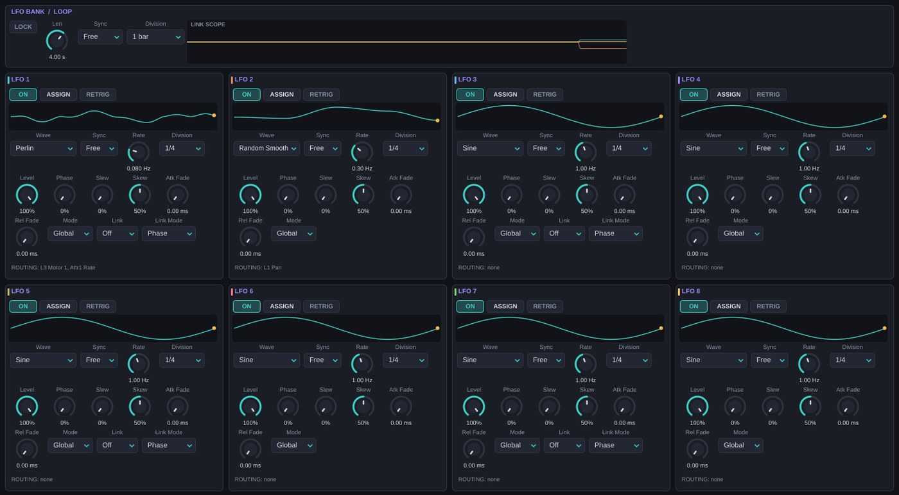
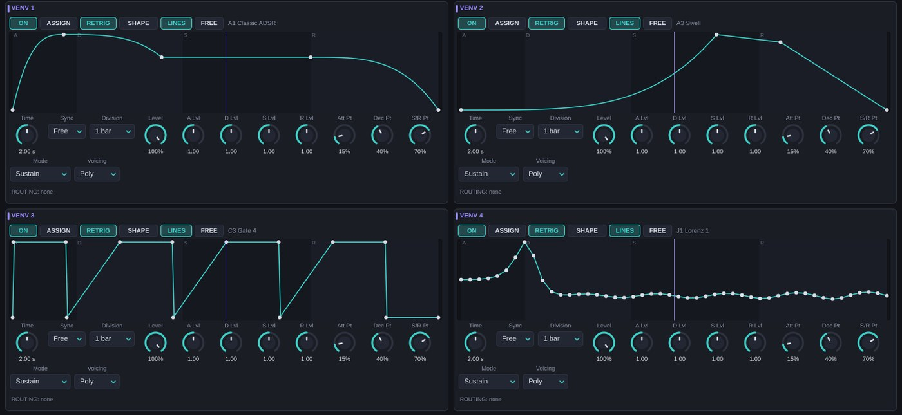
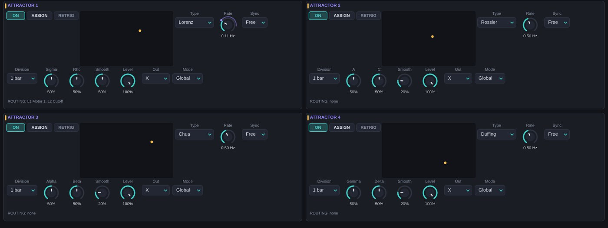
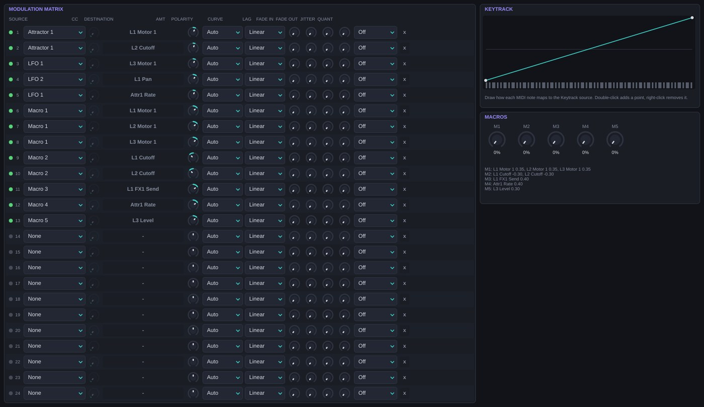
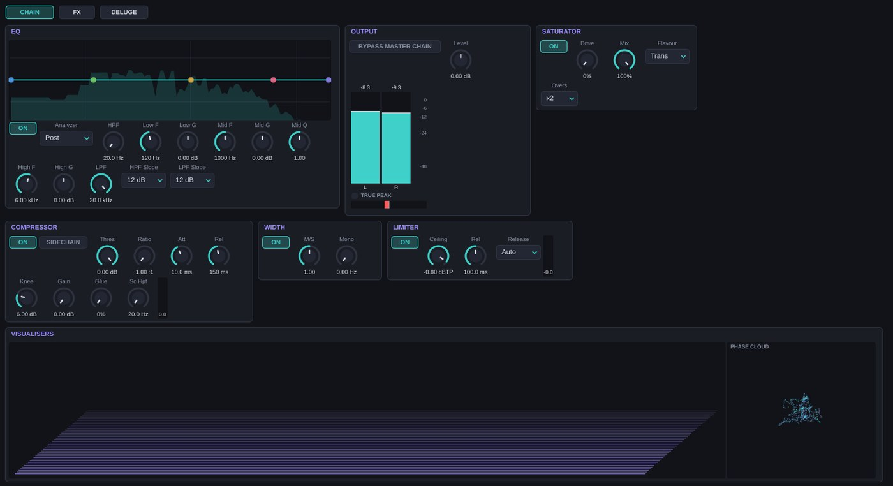
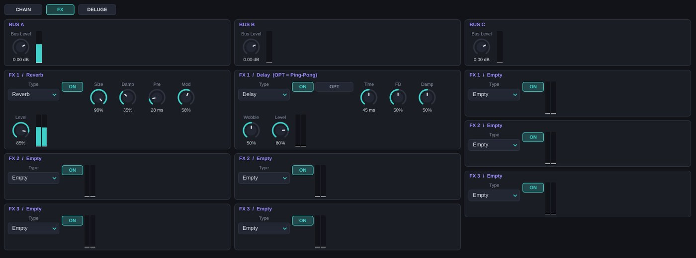
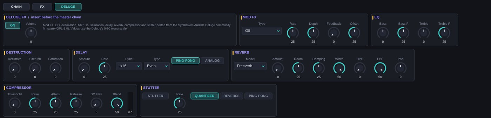

# Filter, envelope, EQ and output {#cadena}

## FILTER {#filtro}

Each lane has a stereo, per-voice filter with fourteen types. The state-variable filters (SVF, Simper's design) stay stable even when the cutoff is modulated at audio rate.

| Type | How it works | Res controls |
| --- | --- | --- |
| LPF | Cascaded SVF low-pass | Resonance of the last stage |
| HPF | Cascaded SVF high-pass | Resonance |
| BPF | Unity-gain band-pass | Narrowness of the band |
| Notch | Band reject | Narrowness |
| Peak | Bell at the cutoff frequency | Gain, up to +18 dB |
| Low Shelf | Bass shelf | Gain, up to +18 dB |
| High Shelf | Treble shelf | Gain, up to +18 dB |
| All-Pass | Changes phase without changing level; useful when modulated | Sharpness of the phase turn |
| Ladder | 4-pole ladder (24 dB/oct) with input saturation, transistor style | Feedback up to self-oscillation |
| Comb | Comb filter: a 1/cutoff delay with feedback. Tuned to Cutoff, not to the note | Feedback (up to 0.97) |
| Formant | Three bands at vowel frequencies; Cutoff sweeps A → E → I → O → U | Narrowness of the formants |
| Phaser | Four staggered all-passes mixed with the dry signal | Feedback |
| Friction | A mass on a belt that sticks and slips (see *Friction and Spring filters*) | Dry friction |
| Spring | A mass on a hardening non-linear spring | Less damping, more non-linearity |

| Parameter | Range (default) | What it does |
| --- | --- | --- |
| Filter Type | The 14 types (LPF) | Type. |
| Filter Slope | 12, 24, 36, 48 dB (12) | Number of stages for LPF, HPF, BPF, Notch and All-Pass. The other types have a fixed slope. |
| Cutoff | 20 Hz – 20 kHz (20 kHz) | Cutoff or centre. Per-note modulatable. |
| Res | 0–100 % (10 %) | See the table above. |
| LPG Mode | Amp, Amp + Filt (Amp) | *Amp + Filt*: the envelope also opens the filter, like a Buchla *low pass gate*. The actual cutoff goes from 20 Hz (envelope at 0) up to Cutoff (envelope at 1). |

To make the filter track the note, create a *Keytrack → Cutoff* route. Comb with that keytrack route and high Res turns any unpitched engine into a plucked string.

## ENV GEN {#envolvente}

One envelope per lane and per note controls the volume (and the filter in LPG mode). Its output is also the matrix source *Lane Env*. It has four modes:

**ADSR.** A classic envelope with delay and per-segment curves.

**Vactrol.** Simulates an opto-coupler (a lamp facing a photoresistor), the heart of *low pass gates*. It has two components, fast and slow, each with its own rise and fall. **Memory** imitates a real photoresistor: the more it has been lit recently, the longer it takes to fade (up to five times longer). Play fast notes and the tails stretch by themselves.

**LFO.** The envelope is a per-note LFO starting at phase 0: tremolos, pulses, free-running rhythmic *gates*.

**VENV.** The envelope is one of the four drawn shapes from the MODULATORS page, with its own time for this lane.

| Parameter | Mode | Range (default) | What it does |
| --- | --- | --- | --- |
| Env Mode | — | ADSR, Vactrol, LFO, VENV (ADSR) | Mode. |
| Env Sub Mode | All | Sustain, One-Shot, Sustain-Loop (Sustain) | *One-Shot*: ignores the end of the note (percussion). *Sustain-Loop*: in VENV mode, loops the sustain zone. |
| Delay | ADSR | 0–2000 ms (0) | Wait before the attack. |
| Attack | ADSR | 0.3 ms – 10 s (5 ms) | Rise. It starts from the current level, so repeated notes don't click. |
| Decay | ADSR | 1 ms – 10 s (300 ms) | Fall to Sustain. |
| Sustain | ADSR | 0–100 % (80 %) | Level while the note is held. |
| Release | ADSR | 1 ms – 15 s (400 ms) | Tail after release. |
| Att / Dec / Rel Curve | ADSR | Lin, Exp, Log (Lin / Exp / Exp) | Shape of each segment. *Exp* sounds natural on falls. |
| Rise Fast / Fall Fast | Vactrol | 0.5–500 ms (5) / 1–2000 ms (80) | Fast component. |
| Rise Slow / Fall Slow | Vactrol | 5–2000 ms (120) / 20–8000 ms (900) | Slow component: the tail. |
| Vac Mix | Vactrol | 0–100 % (50 %) | Weight of the slow component. |
| Memory | Vactrol | 0–100 % (30 %) | Memory effect. |
| Vac Shape | Vactrol | 0–100 % (40 %) | Curvature of the lamp response: higher gives more "pop" and thinner tails. |
| Vac Drift | Vactrol | 0–100 % (10 %) | Random per-note timing variation, up to ±35 %. |
| Env LFO Rate | LFO | 0.05–40 Hz (2) | Speed. |
| Env LFO Shape | LFO | Sine, Triangle, Saw Down, Square, Ramp Up (Sine) | Shape. *Saw Down* gives percussive pulses. |
| Env VENV Shape | VENV | VENV 1–4 (VENV 1) | Shape used. |
| Env VENV Time | VENV | 0.01–30 s (1) | Length of the shape on this lane (independent of the VENV's own Time). |

**MIDI velocity** always scales the level linearly. The matrix source *Velocity* lets you send it to any other destination as well.

## Lane EQ {#eq}

A five-band stereo equaliser on the lane bus: high-pass, low shelf, mid bell, high shelf and low-pass. Drag the nodes on the curve; the wheel changes the mid band's Q or the filters' slope. **EDIT** opens a large editor.

| Parameter | Range (default) |
| --- | --- |
| EQ On | On/Off (On) |
| EQ HPF / HPF Slope | 20 Hz – 2 kHz (20) / 12–48 dB (12) |
| EQ Low Freq / Low Gain | 20 Hz – 1 kHz (120) / ±18 dB (0) |
| EQ Mid Freq / Mid Gain / Mid Q | 100 Hz – 10 kHz (1 kHz) / ±18 dB (0) / 0.2–8 (1) |
| EQ High Freq / High Gain | 1–18 kHz (6 kHz) / ±18 dB (0) |
| EQ LPF / LPF Slope | 200 Hz – 20 kHz (20 kHz) / 12–48 dB (12) |

### Snapshots and morph {#eq-morph}

The EQ stores up to **four curves** (snapshots A–D):

1. Set up a curve on A.
2. Select B: the first time, B copies the current curve. Edit it.
3. Repeat with C and D if you like.
4. **EQ Morph** (0–100 %) travels through the used snapshots in the order A → B → C → D, interpolating frequencies logarithmically and gains linearly.

Selecting a snapshot moves the morph onto it, so you hear what you edit. **RST** returns to a single flat snapshot. EQ Morph is a modulation destination (for global sources): a slow LFO on it gives several bands of filtering moving together.

## OUTPUT {#salida}

| Parameter | Range (default) | What it does |
| --- | --- | --- |
| Level | −60 to +12 dB (0) | Lane volume. Per-note modulatable. |
| Pan | −1 to +1 (0) | Lane pan. |
| Width | 0–2 (1) | M/S width: 0 mono, 1 natural, 2 double sides. |
| Voice Spread | −1 to +1 (0) | Places each voice at a fixed stereo position according to note order (left, right, centre-left…). The sign flips the sides. A chord opens up like a section. |
| Bass Mono | 0–500 Hz (0 = off) | Below this frequency the lane is mono. |
| Drive | 0–100 % (0) | Saturation on the lane bus, with up to ×15 gain and level compensation. |
| Drive Flavour | Tape, Clip, Fold, Transformer, Wavefolder (Tape) | See table. |
| FX1 / FX2 / FX3 Send | −60 to 0 dB (−60 = off) | Send to buses A, B and C (post-fader). |

| Flavour | Character |
| --- | --- |
| Tape | Asymmetric hyperbolic tangent: even harmonics, warm, gentle compression. |
| Clip | Hard clipping: aggressive, digital. |
| Fold | Sine folding: as you push it the wave folds over itself and metallic harmonics appear. |
| Transformer | Saturation with a transformer's rounded "shoulder": dense, odd harmonics. |
| Wavefolder | Multiple triangle folding, West Coast style: very bright, timbre changes with input level. |

Pan, Width, Drive, the sends and EQ Morph act on the lane bus, so they only accept modulation from global sources. The matrix marks a route that cannot have any effect in red.

# Modulation {#modulacion}

Caosmo has 16 modulators and 24 routes. There are two ways to connect them:

- **ASSIGN**: press ASSIGN on a modulator and click any control. Esc cancels.
- **Right-click → Modulate with…** on the destination control.

Both create a route in the matrix, where you can fine-tune its amount, curve and behaviour.

**Global and Poly.** A *Global* modulator is a single instance shared by every note: ideal for ensemble movement and for lane-bus or master destinations. A *Poly* modulator has an independent copy per note, starting with the note: every voice moves on its own.

## LFO ×8 {#lfo}

| Parameter | Range (default) | What it does |
| --- | --- | --- |
| On | On/Off (On) | Enables the LFO. |
| Wave | Sine, Triangle, Saw Up, Saw Down, Pulse, Random S&H, Random Smooth, Perlin, Brownian, Geo Brownian, Noise Ring, Markov (Sine) | Shape. *Random S&H*: random steps. *Random Smooth*: interpolated random. *Perlin*: two-octave gradient noise, organic. The last four have memory (see *LFO waves with memory*). |
| Rate | 0.01–50 Hz (1) | Free-running speed. Modulatable. |
| Sync | Free, Host (Free) | *Host*: synced to the DAW position (in Global mode with the transport running it follows the ruler). |
| Division | 8 bars … 1/32, 1/4T, 1/8T, 1/16T, 1/4D, 1/8D (1/4) | Length of one cycle in Host mode. Rate modulation multiplies it by powers of 2. |
| Level | 0–100 % (100 %) | Amplitude. Modulatable. |
| Phase | 0–100 % (0) | Start phase (and offset in Host mode). |
| Slew | 0–100 % (0) | Smooths the jumps of Pulse and S&H. |
| Skew | 0–100 % (50 %) | Moves the midpoint of the cycle: a triangle becomes a saw; a pulse changes its width. |
| Atk Fade | 0–5000 ms (0) | Gradual fade-in of the LFO after the note starts. |
| Rel Fade | 0–5000 ms (0) | Gradual fade-out after release. |
| Mode | Global, Poly (Global) | One instance or one per note. |
| Retrig | On/Off (Off) | Restarts the phase on every note. |
| Dist | The 10 distributions (Uniform) | Distribution of the values of Random S&H, Random Smooth and the waves with memory. |

### Links (LINK) {#lfo-link}

LFOs 1, 3, 5 and 7 can lead the following ones. Followers take the leader's speed but keep their own wave, Level and Skew.

| Link | Group |
| --- | --- |
| Dual (LFO 1, 3, 5, 7) | The LFO and the next one: 1–2, 3–4, 5–6, 7–8. |
| Quad (LFO 1 and 5) | Four LFOs: 1–4 or 5–8. |
| Oct (LFO 1) | All eight. |

| Link Mode | Relationship of each follower k (1, 2, 3…) |
| --- | --- |
| Sync | Same phase as the leader. |
| Phase | Spread phases: k/n of a cycle offset. Ideal for fanned movement and circular panning. |
| Divide | Leader speed ÷ (k+1): 1:2:3:4 polyrhythms. |
| Pendulum | Odd followers run each cycle backwards. |
| Mirror | Odd followers invert their output. |

### Loop Lock {#lfo-loop}

Random shapes normally never repeat. **Loop Lock** restarts their generator at a set interval, so the same random sequence comes back again and again: randomness shaped like a *riff*.

| Parameter | Range (default) |
| --- | --- |
| LFO Loop Lock | On/Off (Off) |
| LFO Loop Len | 0.25–16 s (4); modulatable |
| LFO Loop Sync | Free, Host (Free) |
| LFO Loop Division | 1/4 bar, 1/2 bar, 1/2T bar, 3/4 bar, 1 bar, 1T bar, 1.5 bars, 2, 3, 4, 6 or 8 bars (1 bar) |

## VENV ×4 {#venv}

VENVs are drawable envelopes: a free shape travelled over a given time, with attack, decay, sustain and release zones.

**Editor.** In **LINES** mode you drag points; double-click adds one; right-click deletes it or changes the segment's curvature; Alt snaps to the grid; the wheel zooms; Shift + drag pans the view. In **FREE** mode you draw freehand. The shape menu has **100 factory shapes** in ten banks (A–J) plus your saved shapes.

| Parameter | Range (default) | What it does |
| --- | --- | --- |
| On | On/Off (On) | Enables the VENV. |
| Time | 0.01–30 s (2) | Total length. Modulatable. |
| Sync / Division | Free, Host / LFO divisions (Free / 1 bar) | Length in musical time. |
| Level | 0–100 % (100 %) | Amplitude. Modulatable. |
| Attack / Decay / Sustain / Release Lvl | 0–2 (1) | Scales each zone without redrawing. |
| Attack Pt / Decay Pt / Sus-Rel Pt | 0–100 % (15 / 40 / 70 %) | Zone boundaries on the shape. |
| Mode | 1-Shot, Sustain, Sustain-Loop (Sustain) | *1-Shot*: plays the whole shape. *Sustain*: stops at the start of the Sus-Rel zone until release. *Sustain-Loop*: loops the sustain zone (yellow band) while the note is held. |
| Voicing | Global, Poly (Poly) | Per note or shared. |
| Retrig | On/Off (On) | Restarts on every note. |

A long 1-Shot VENV on a chaos parameter is the most direct way to write a sound's "story".

## Attractors ×4 {#atractores}

Modulators that follow the trajectory of a strange attractor: smooth, never repeating, with correlation between their three coordinates. The rotating 3-D portrait shows the orbit.

| Type | P1 | P2 | Character |
| --- | --- | --- | --- |
| Lorenz | σ 5–20 | ρ 20–45 | Two lobes: the signal jumps unpredictably between two zones. |
| Rossler | a 0.1–0.3 | c 4–9 | An almost periodic spiral with occasional leaps. |
| Chua | α 8–11 | β 12–18 | Double scroll: alternates between two centres. |
| Duffing | γ 0.2–0.6 | δ 0.1–0.4 | Forced oscillation with well jumps; Z follows the force. |
| Sprott B | a 0.6–1.4 | b 0.5–1.5 | A smooth, symmetric attractor. |
| Henon … ACT | | | Seven new types in version 0.5: see *New attractors*. |

| Parameter | Range (default) | What it does |
| --- | --- | --- |
| On | On/Off (On) | Enables the attractor. |
| Type | The 12 types (1 Lorenz, 2 Rossler, 3 Chua, 4 Duffing) | System. |
| Rate | 0.01–20 Hz (0.5) | Speed. Modulatable. |
| Sync / Division | Free, Host / divisions (Free / 1 bar) | Speed tied to tempo. |
| P1 / P2 | 0–100 % (50 %) | Coefficients (see table). |
| Smooth | 0–100 % (20 %) | Output smoothing. |
| Level | 0–100 % (100 %) | Amplitude. Modulatable. |
| Out | X, Y, Z, Blend (X) | Coordinate used. |
| Mode | Global, Poly (Global) | In Poly, each note has its own attractor with its own seed. |
| Retrig | On/Off (Off) | Restarts on every note. |

An attractor modulating the Rate of another attractor (or of an LFO) creates coupled systems: the *Weather Systems* category is built that way.

## Matrix ×24 {#matriz}

Each route takes a source to a destination with its own processing. The **x** at the end of the row deletes the route; the row's **CC** button learns a controller for that route.

| Parameter | Range (default) | What it does |
| --- | --- | --- |
| Source | 37 sources (None) | Where the modulation comes from. |
| Dest | Grouped destinations (None) | The parameter being modulated. |
| Amount | −1 to +1 (0) | Amount. ±1 covers the destination's full range. |
| Polarity | Auto, Unipolar, Bipolar (Auto) | *Auto* respects the source's nature (LFOs, attractors, keytrack, pitch bend and Note Random are bipolar; the rest are unipolar). *Unipolar* / *Bipolar* convert it. |
| Curve | Linear, Exp, Log, S-Curve (Linear) | Response. *Exp*: more detail at low values (ideal for velocity). *Log*: faster at the start. *S-Curve*: softens the extremes. |
| Lag | 0–1000 ms (0) | Smoothing: turns steps into ramps. |
| Fade In | 0–5000 ms (0) | The route fades in after the note starts (delayed vibrato). |
| Fade Out | 0–5000 ms (0) | The route fades out after release. |
| Jitter | 0–100 % (0) | Adds smoothed random variation. |
| Quant | Off, Semitone, Major, Minor, Penta, Chromatic (Off) | Lane *Pitch* destinations only: rounds the modulation to semitones or to scale intervals counted from the note played. |
| CC | 0–127 (1) | Controller number when the source is *CC*. |

### Sources {#matriz-fuentes}

| Group | Sources | Per note |
| --- | --- | --- |
| LFOs | LFO 1–8 | When in Poly |
| VENV | VENV 1–4 | When in Poly |
| Attractors | Attractor 1–4 | When in Poly |
| Envelopes | Lane 1–3 Env | Yes |
| MIDI | Velocity, Release Vel, Keytrack, Mod Wheel, Aftertouch, Pitch Bend, Expression (CC 11), Sustain (CC 64), CC | Velocity, Release Vel and Keytrack |
| MPE | MPE Pressure, MPE Slide (CC 74), MPE Bend | Yes |
| Macros | Macro 1–5 | No |
| Triggers | Trig 1–4 | No |
| Other | Note Random (a fixed random value per note, shaped by *Note Random Dist*) | Yes |

### Destinations {#matriz-destinos}

| Group | Destinations |
| --- | --- |
| Lane 1–3 (per note) | Pitch, Fine, Cutoff, Res, Level, V.Spread, Sub1 Lev, Sub2 Lev, Motor 1–6, Env Att, Env Dec, Env Sus, Env Rel |
| Lane 1–3 (global only) | Pan, Width, Drive, FX1–3 Send, EQ Morph |
| Modulators | LFO 1–8 Rate and Level, VENV 1–4 Time and Level, Attr 1–4 Rate and Level |
| Triggers | Trig 1–4 Rate and Prob |
| Global | LFO Loop Len, Glide |
| Master | Master Low Gain, Mid Gain, High Gain, Sat Drive, Sat Mix, Comp Thresh, Master Width, Output Gain |
| FX | FX A/B/C Level and P1–P5 of each of the 9 slots |

### Status lights {#matriz-luces}

| Light | Meaning |
| --- | --- |
| Green | The route is active. |
| Blue | Modulation loop: a modulator modulates itself through others. It works, but it can become unstable. |
| Amber | The destination is a *Motor N* the current engine doesn't have (e.g. Motor 5 on Chua). |
| Red | Per-note source to a global destination: the route has no effect. |

## Keytrack {#keytrack}

A drawable curve that turns the MIDI note (0 to 127) into a modulation value. Double-click adds a point and right-click removes it. The *Keytrack* source outputs that value. By default it is a straight line, but you can make only high notes modulate, keep the middle of the keyboard neutral, or give each zone different behaviour. The *Strata* category uses curves that make high notes unstable.

## Macros {#macros}

Five global controls (0–100 %) on the bottom bar (M1–M5), meant for playing and automating. *Right-click a control → Send to Macro* creates the route directly. The **MACROS** view on the MATRIX page shows what each one moves. Every factory preset has all five macros assigned to something audible.

## MIDI, MIDI Learn and MPE {#mpe}

- **MIDI Learn**: right-click a control → *MIDI / MPE → MIDI Learn* and move a controller. Caosmo creates a *CC* route in the matrix, so it is saved with the preset and you can adjust its amount and curve.
- **Per-lane channel**: in LANE, for splits or three parts from three MIDI tracks.
- **PB Range**: global pitch-bend range, 0–24 semitones (2).
- **MPE**: choose *Lower* (master channel 1, notes on 2–16) or *Upper* (master channel 16, notes on 1–15). Each note gets its own bend (*MPE PB Range*, 0–96 semitones, 48 by default), pressure and slide (CC 74), available as per-note sources. With MPE on, lane channels are ignored.

In REAPER, for MPE set the track's MIDI input to *All channels* and don't force a channel on the send to the plugin.

# Master {#master}

The master chain processes the final sum: **EQ → Saturator → Compressor → Width → Limiter → Output**.

| Parameter | Range (default) | What it does |
| --- | --- | --- |
| Bypass Master Chain | On/Off (Off) | Skips EQ, saturator, compressor and width. Limiter and Output stay active. |
| Master EQ On and bands | Same as the lane EQ | Five-band EQ on the mix. |
| Analyzer | Off, Pre, Post, Pre+Post (Post) | Spectrum before and/or after the EQ, drawn under the curve. |
| Sat On | On/Off (On) | Enables the saturator. |
| Sat Drive | 0–100 % (0) | Gain into the saturation, up to ×21, with compensation. |
| Sat Mix | 0–100 % (100 %) | Dry/saturated mix (parallel). |
| Sat Flavour | Trans, Tube (Trans) | *Trans*: firm symmetric curve, odd harmonics. *Tube*: biased curve, even harmonics, warmer. |
| Sat Oversampling | Off, x2, x4 (x2) | Oversampling that reduces saturation aliasing. |
| Comp On | On/Off (On) | Enables the compressor. With Ratio 1:1 and Makeup 0 it does nothing. |
| Comp Thresh | −60 to 0 dB (0) | Threshold. Modulatable. |
| Comp Ratio | 1:1 – 20:1 (1:1) | Ratio. |
| Comp Attack / Release | 0.1–200 ms (10) / 10–2000 ms (150) | Times. |
| Comp Knee | 0–24 dB (6) | Soft knee. |
| Comp Makeup | 0–24 dB (0) | Makeup gain. |
| Comp Glue | 0–100 % (0) | Blends detection from the input (*feed-forward*, precise) with detection from the output (*feedback*, like classic bus compressors): more glue, softer, "stickier" compression. |
| Comp SC HPF | 20–500 Hz (20) | High-pass on the detector: lows stop pumping the compressor. |
| Comp Ext Sidechain | On/Off (Off) | The detector listens to the plugin's sidechain input. Enable it and route audio to it in the DAW. |
| Width On / Master Width | On / 0–2 (1) | M/S width. |
| Master Bass Mono | 0–500 Hz (0 = off) | Lows in mono below this frequency. |
| Limiter On | On/Off (Off) | Limiter with 1.5 ms look-ahead and inter-sample *true peak* estimation. |
| Limiter Ceiling | −12 to 0 dBTP (−1) | Ceiling. |
| Limiter Release | 1–1000 ms (100) | Release in Manual mode. |
| Limiter Release Mode | Manual, Auto (Auto) | *Auto*: from 30 ms to about 630 ms depending on average reduction; transparent on dense material. |
| Output Gain | −60 to +12 dB (0) | Final volume. Modulatable. |

**Latency.** The plugin always reports 1.5 ms of latency (the look-ahead), whether the limiter is on or not. That way the DAW compensates without jumps when you switch it.

**Meters.** Peak, true peak, compressor and limiter gain reduction, and stereo correlation (+1 mono, 0 decorrelated, −1 out of phase).

**Visualisers.** Spectral waterfall, phase cloud, terrain and galaxy. Click to change view, wheel to zoom and right-click to change palette. They are purely visual.

# Effect buses {#fx}

Three buses (A, B and C) fed by the lane sends. Each bus has three slots in series and returns its signal 100 % wet to the mix, before the Deluge rack and the master. By default bus A holds a Reverb and bus B a Delay.

| Parameter | Range (default) | What it does |
| --- | --- | --- |
| Bus Level | −60 to +6 dB (0) | Return level. Modulatable. |
| Slot Type | Empty, Reverb, Delay, Freq Shift, Granular, Howl, Ring Mod, Diffuse, Mag Noise, Rand Comb, Noise Synth, Wave Loss, Squiz | Effect. The last six are described in *Spectral and cycle effects*. |
| Slot On | On/Off (On) | Enables the slot. |
| P1–P5 | 0–100 % (50 %; P5 80 %) | Effect-dependent parameters. All modulatable. |
| Option | On/Off (Off) | Delay: Stereo / Ping-Pong. Granular, Diffuse and Rand Comb: Live / Freeze. Noise Synth: Unstable / Stable. Wave Loss: Random / Regular. |

| Effect | P1 | P2 | P3 | P4 | P5 |
| --- | --- | --- | --- | --- | --- |
| Reverb | Size | Damp | Pre (0–200 ms) | Mod | Level |
| Delay | Time (1 ms – 2 s) | FB (0–98 %) | Damp | Wobble | Level |
| Freq Shift | Shift (±2 kHz) | FB | Level | — | — |
| Granular | Size (10–500 ms) | Density (1–40 grains/s) | Scatter | Pitch (±24 st) | Level |
| Howl | Freq (40 Hz – 4 kHz) | FB (0–120 %) | Damp | Drive | Level |
| Ring Mod | Freq (1 Hz – 4 kHz) | Level | — | — | — |

- **Reverb**: a feedback delay network with Hadamard mixing, pre-delay and diffusers. *Mod* adds movement to the lines (chorus in the tail).
- **Delay**: stereo or ping-pong, with a filter in the feedback (*Damp*) and *Wobble*, a slow tape-like time drift.
- **Freq Shift**: Hilbert-transform frequency shifter. It moves every frequency by the same amount (inharmonic). With FB it makes rising or falling spirals.
- **Granular**: records the input into a buffer and plays it back in grains. *Freeze* freezes the buffer.
- **Howl**: a delay tuned to *Freq* with a band-pass in the feedback: mic-and-speaker style howl. Above 100 % FB it can self-oscillate; *Drive* saturates it.
- **Ring Mod**: multiplies the signal by a sine: from tremolo (low frequencies) to inharmonic bells.

# DELUGE FX {#deluge}

The DELUGE FX rack holds the effects from the **Synthstrom Audible Deluge** community firmware, copied from its open-source repository and compiled as is: the same 32-bit fixed-point arithmetic, the same 64-sample blocks and the same tables. It is an insert placed between the sum of lanes and FX and the master chain.

The controls use the Deluge's **0–50 menu scale** (−25 to +25 for bipolar ones) and go through the firmware's own conversions. With everything at its neutral position the level does not change.

The internal order is the Deluge's: stutter → Mod FX → EQ → delay → decimation and bitcrush → saturation → reverb → compressor.

## Mod FX {#dl-mod}

| Parameter | Range (default) | What it does |
| --- | --- | --- |
| Mod FX | Off, Flanger, Chorus, Phaser, Stereo Chorus, Warble, Dimension, Grain (Off) | Type. |
| Rate | 0–50 (25) | Speed of the internal LFO. In Grain: grain rate. |
| Depth | 0–50 (25) | Depth. In Grain: mix. **At 0 the Mod FX is off** (as on the Deluge), except Grain. |
| Feedback | 0–50 (0) | Feedback (flanger, phaser). In Grain: pitch randomness. |
| Offset | 0–50 (25) | Base delay of flanger/chorus or phaser centre. In Grain: density. |

*Warble* is a chorus with irregular, tape-like modulation. *Dimension* is inspired by the Roland Dimension D stereo chorus. *Grain* is the Deluge's granulator, which feeds the reverb.

## EQ and destruction {#dl-eq}

| Parameter | Range (default) | What it does |
| --- | --- | --- |
| Bass / Treble | −25 to +25 (0) | Bass and treble shelves. |
| Bass Freq / Treble Freq | 0–50 (25) | Frequency of each shelf. |
| Decimation | 0–50 (0) | Sample-rate reduction (deliberate aliasing). |
| Bitcrush | 0–50 (0) | Resolution reduction. |
| Saturation | 0–15 (0) | The Deluge's digital saturation. |

## Delay {#dl-delay}

| Parameter | Range (default) | What it does |
| --- | --- | --- |
| Amount | 0–50 (0) | Echo feedback and level. 0 = off. |
| Rate | 0–50 (25) | Without sync: the time. With sync: multiplies the synced time (25 = exact). |
| Sync | Off, 2 bars, 1 bar, 1/2, 1/4, 1/8, 1/16, 1/32, 1/64, 1/128 (1/16) | Time locked to the DAW tempo. |
| Sync Type | Even, Triplet, Dotted (Even) | Note value. |
| Ping-Pong | On/Off (On) | Stereo bounce. |
| Analog | On/Off (Off) | Analogue mode: saturation and the response of a *bucket brigade* (BBD) delay via an impulse response. |

## Reverb {#dl-reverb}

| Parameter | Range (default) | What it does |
| --- | --- | --- |
| Model | Freeverb, Mutable, Digital (Freeverb) | *Freeverb*: Jezar's classic, dense and bright. *Mutable*: derived from the reverb in Mutable Instruments modules, diffuse and modulated. *Digital*: the Deluge's own algorithm. |
| Amount | 0–50 (0) | Reverb send. 0 = off. |
| Room / Damping / Width | 0–50 (25 / 25 / 50) | Size, high-frequency absorption and width. |
| HPF / LPF | 0–50 (0 / 50) | Tail filters. |
| Pan | −25 to +25 (0) | Reverb position. |

## Compressor {#dl-comp}

The Deluge's master compressor: RMS detection with feedback, very musical when pumping.

| Parameter | Range (default) | What it does |
| --- | --- | --- |
| Threshold | 0–50 (0) | Amount of compression. 0 = off. |
| Ratio | 0–50 (25) | Ratio. |
| Attack / Release | 0–50 (25) | Times. |
| Sidechain HPF | 0–50 (0) | High-pass on the detector. |
| Blend | 0–50 (50) | Parallel compression: 50 = fully compressed. |

The tab has its own gain-reduction meter.

## Stutter and volume {#dl-stutter}

| Parameter | Range (default) | What it does |
| --- | --- | --- |
| Stutter | On/Off (Off) | While on, repeats the fragment that has just played (*beat repeat*). Meant to be automated or mapped to a MIDI button. |
| Stutter Rate | 0–50 (25) | Repeat length. It is fixed when the stutter starts. |
| Quantized | On/Off (On) | Snaps the length to the tempo grid. |
| Reversed | On/Off (Off) | Repeats backwards. |
| Ping-Pong | On/Off (Off) | Alternates forwards and backwards. |
| Volume | −25 to +25 (0) | Output level of the rack. |

**Tip.** Automate *Deluge Stutter* in REAPER with a short automation item on the last beat of a bar: fill-style repeats.
