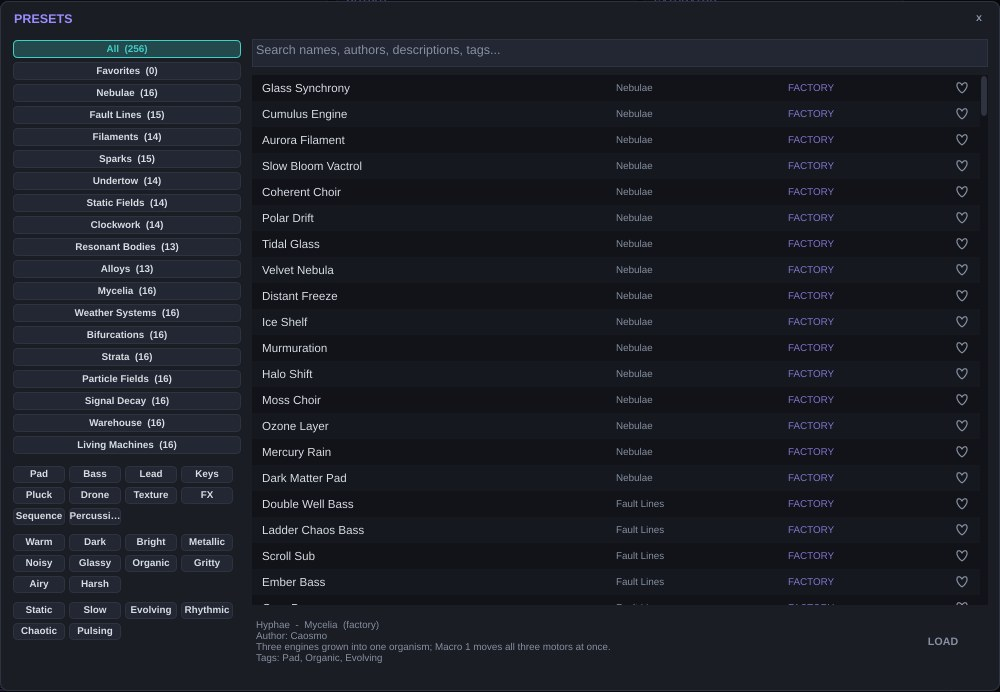
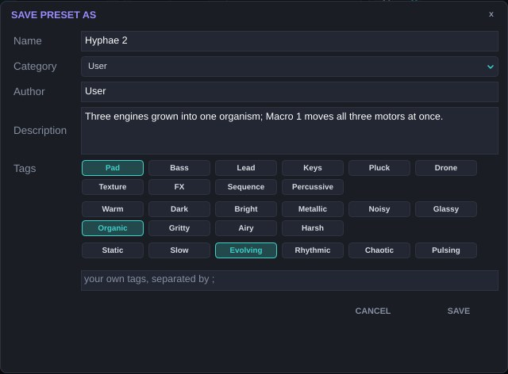

# Presets {#presets}

## The browser {#presets-navegador}

Click the preset name or **BROWSE**. The browser combines four filters:

- **Category**: *All*, *Favorites*, the 17 factory categories and those of your own presets, each with its preset count.
- **Favourites**: the heart next to each preset.
- **Tags** in three families, combined with AND (a preset must have every tag you select):
  - **Type**: Pad, Bass, Lead, Keys, Pluck, Drone, Texture, FX, Sequence, Percussive.
  - **Character**: Warm, Dark, Bright, Metallic, Noisy, Glassy, Organic, Gritty, Airy, Harsh.
  - **Motion**: Static, Slow, Evolving, Rhythmic, Chaotic, Pulsing.
- **Search** by text in name, author, description and tags.

When you select a preset, the bottom area shows its category, author, description and tags. **LOAD** loads it.

The arrows on the top bar step through the filtered list.

## Saving {#presets-guardar}

**SAVE AS** asks for a name, category, author, description and tags, plus your own tags separated by semicolons. **SAVE** overwrites the current user preset. Caosmo **suggests character tags** based on the engines of the active lanes (for example Glassy and Airy for Kuramoto, Metallic and Bright for Circle Map). Add Type and Motion and check them before saving. User presets are saved as `.caosmo` files in `Documents/Caosmo Presets/User`. Right-click a user preset to edit its information, rename it or delete it.

A preset stores every parameter, the routes (including those created with MIDI Learn), the four VENV shapes, the keytrack curve and the EQ snapshots. It does not store interface preferences. *Settings → OPEN PRESETS FOLDER* opens the preset folder.

## The 17 categories {#presets-categorias}

| Category | Presets | What you'll find |
| --- | --- | --- |
| Nebulae | 16 | Wide, evolving pads. |
| Fault Lines | 15 | Basses: double wells, saturated ladders, sub-scrolls. |
| Filaments | 14 | Leads and melodies. |
| Sparks | 15 | Plucks, mallets, percussion. |
| Undertow | 14 | Deep drones. |
| Static Fields | 14 | Noise, textures, effects. |
| Clockwork | 14 | Sequences, arpeggios and synced pulses. |
| Resonant Bodies | 13 | Strings, bells and physical bodies. |
| Alloys | 13 | Multi-engine combinations. |
| Mycelia | 16 | Three engines behaving as one organism; Macro 1 moves all three at once. |
| Weather Systems | 16 | Attractors modulating each other: slow changes of "weather". |
| Bifurcations | 16 | A VENV drives a chaos parameter from order to turbulence; aftertouch pushes it further. |
| Strata | 16 | Low drones in which the keytrack makes high notes unstable. |
| Particle Fields | 16 | Grain clouds with Loop Lock: randomness that repeats. |
| Signal Decay | 16 | Unstable loops, frequency-shifter feedback, degradation. |
| Warehouse | 16 | Techno textures: linked LFOs, synced *gates*, stutter. |
| Living Machines | 16 | Sixteen interconnected modulators: self-organising systems. |

The full list is in the appendix.

## How they were made {#presets-como}

The presets are described in text files, and a program generates, renders and measures them. Every preset is **automatically levelled** to about −18 dBFS RMS and checked so its true peak stays below −0.8 dBTP; how much the sound evolves over time is also measured, so presets tagged *Evolving* or *Chaotic* really are. That's why you can browse the bank without level jumps.

# Tutorials {#tutoriales}

Every recipe starts from the initial patch: *Settings → RESET TO INIT*. The values are starting points: listen and adjust.

## A pad that synchronises {#tut-pad}

1. L1 Engine **Kuramoto**. Ratio **Harmonic**, Spread **0.6**, N Osc **8**, Out **Coherent**.
2. ENV GEN: Attack **1.5 s**, Release **3 s**.
3. FILTER: LPF 24 dB, Cutoff **3 kHz**, Res **20 %**.
4. MODULATORS: LFO 1 on **Random Smooth**, Rate **0.08 Hz**. ASSIGN → click **K** (on MAIN). In the matrix, Amount **0.35**.
5. Raise K until you hear the sound drift in and out of lock.
6. FX1 send at **−8 dB** (bus A's Reverb).

For more life: Drift Pitch **Subtle** and, on L2, the same engine with Ratio **Golden** and Level **−9 dB**.

## A double-well bass with bite {#tut-bajo}

1. L1 **Duffing**: Gamma **0.28**, Delta **0.18**, Omega **1**, Out **Position**.
2. Voices **1**, Legato **On**, Glide **40 ms**.
3. FILTER: **Ladder**, Cutoff **400 Hz**, Res **35 %**, LPG **Amp + Filt**.
4. ENV GEN: Attack **2 ms**, Decay **350 ms**, Sustain **40 %**.
5. Matrix: *Velocity → L1 Motor 1* (Gamma), Amount **0.3**, Curve **Exp**. Playing hard makes the mass jump between wells.
6. OUTPUT: Drive **25 %** Tape, Bass Mono **120 Hz**.

## Sand-and-metal percussion {#tut-perc}

1. L1 **Logistic/Henon**: Morph **0.3**, Smooth **0.55**.
2. ENV GEN: ADSR **One-Shot**, Attack **0.3 ms**, Decay **90 ms**, Sustain **0**.
3. FILTER: **BPF**, Res **60 %**. Matrix: *Keytrack → L1 Cutoff*, Amount **0.5**.
4. L2 **Chua** Alpha **10.5**, same envelope with Decay **40 ms**, Level **−6 dB**: the "hit".
5. Matrix: *Note Random → L1 Cutoff*, Amount **0.08**: every hit sounds different.

## A cloud that rewrites itself {#tut-nube}

1. L1 **Wave Grains**: Size **60 ms**, Count **10**, Scatter **0.7**, Spray **0.9**, Jitter **0.2**.
2. Chaos **Rossler**, Chaos Rate **0.3 Hz**, Chaos>X **0.6**, Chaos>Y **0.5**, Chaos>Fold **0.3**, Tau **0.6**. Grain **Frozen**.
3. ENV GEN: Vactrol with Rise Slow **800 ms** and Fall Slow **4 s**.
4. LFO 2 on Random S&H, Sync Host **1/8**, to *L1 Motor 5* (Size ms) with Amount **0.25**. Turn on **Loop Lock** with Division **2 bars**: the grain size changes the same way every time, like a sequence.
5. In MASTER → FX, set slot 2 of bus B to **Granular** with Option **Freeze**, and raise the lane's FX2 send to **−12 dB**.

## An expressive MPE cello {#tut-cello}

1. Settings: MPE **Lower**, MPE PB Range **48** (or whatever your controller uses).
2. L1 **Bowed String**: Press **0.5**, Speed **0.5**, Pos **0.18**, Body **0.6**, Rasp **0.15**.
3. ENV GEN: **Vactrol**, Rise Fast **20 ms**, Fall Slow **1.2 s**.
4. Matrix: *MPE Pressure → L1 Motor 2* (Speed) Amount **0.5**; *MPE Pressure → L1 Motor 1* (Press) Amount **0.25**; *MPE Slide → L1 Motor 3* (Pos) Amount **0.3**.
5. LFO 1 **Poly**, Sine **5.5 Hz**, to *L1 Fine* Amount **0.08**, with **Fade In 600 ms**: a late vibrato, like a player's.

## A techno drone with the Deluge {#tut-techno}

1. L1 **Mackey-Glass**: Sharp **0.45**, Crackle **0.1**, Octave **Fixed**. L2 **Gray-Scott** with BPF **0.6**.
2. LFO 1 Sync Host **1/16**, Pulse, to *L1 Level* and *L2 Level* (negative Amount, −0.6): a rhythmic gate. Link **Dual** with Link Mode **Divide**: LFO 2 at half speed, to L2 Cutoff.
3. MASTER → DELUGE: Deluge FX **On**; Mod FX **Dimension** (Depth 20); Delay Amount **18**, Sync **1/8**, Dotted, Analog **On**; Reverb **Mutable** Amount **15**; Compressor Threshold **20**, Blend **35**.
4. In REAPER, automate **Deluge Stutter** on the last beat of every four bars.

## Writing a bifurcation {#tut-bifurcacion}

1. L1 **Sprott**: Chaos **0.1**, Damp **1**, Out **X**.
2. VENV 1: draw a slow ramp from 0 to 1 with a plateau at the end. Mode **1-Shot**, Time **12 s**, Voicing **Poly**.
3. Matrix: *VENV 1 → L1 Motor 1* (Chaos), Amount **0.7**.
4. Hold a note: the tone splits into sub-octaves and ends in turbulence. *Aftertouch → L1 Motor 1* with Amount **0.2** lets you push it live.

# Performance and CPU {#rendimiento}

The cost depends on **voices × lanes × engine**. Some guidelines:

- The lightest engines are Logistic/Henon, Duffing, Sprott, Chua and Circle Map. The heaviest are Lorenz Additive (with Engine HQ), Wave Grains with a high Count, Kuramoto with 12 oscillators, and Gray-Scott.
- **Sub 1** doubles the cost of that lane's engine; **Sub 2** is free.
- **Poly** modulators cost one instance per voice.
- Lower **Voices** to what you need: 8 is usually enough for pads, 1–4 for basses and leads.
- Switch **Engine HQ** off if you don't use Lorenz Additive or are short of CPU.
- Switch unused lanes off with **PWR** (Mute does not save CPU).
- Visualisers only use CPU while the window is open; close it or pause them in Settings.
- In the DAW, render or freeze tracks in large mixes.

# Troubleshooting {#problemas}

| Symptom | Likely cause and fix |
| --- | --- |
| No sound | Does the lane have an engine and PWR on? Does the lane's MIDI channel match? Has Gray-Scott with Drift 0 died out? Bowed String with Press or Speed at 0? |
| Sound, but no pitch | The engine is unpitched (Lorenz+Rossler, Logistic/Henon, Gray-Scott without BPF). Raise Sub 2 or use a Comb/BPF filter with keytrack. |
| The note jumps an octave | Mackey-Glass on Octave Free, or Sprott/Chua in a period-doubling zone. Use Octave Fixed or lower the chaos parameter. |
| Clicks when playing fast | Very short Attack with an engine that starts with lots of energy. Raise Attack to 2–5 ms or use Vactrol. |
| Level jumps | A system crossing into chaos. Enable the master limiter or lower the chaos parameter. |
| Plugin missing (macOS) | Gatekeeper: run `xattr -dr com.apple.quarantine` on `Caosmo.vst3`. |
| Plugin missing (Windows) | `Common Files\VST3` is not in the DAW's paths, or the copy lacked permissions. |
| Slow with many voices | See the performance chapter. |
| MPE not responding | MPE Mode on, the right zone (Lower/Upper), and the DAW track receiving all channels. |
| A route does nothing | Check its light in the matrix: red (per-note source to a global destination) or amber (engine parameter that doesn't exist). |
| No stutter heard | Deluge FX **On**. Stutter repeats what has just played: switch it on while audio is sounding. |

# How it was made {#comosehizo}

Caosmo was built over four versions, from a playable core to a complete instrument with effects and binaries for three systems.

## Research {#hizo-investigacion}

The starting point was Fragua's public documentation: its three-lane architecture, the list of engines, the description of each control and the published demos. From there each system was reimplemented from its original equations in the scientific literature (Kuramoto, Duffing, Sprott, Lorenz, Rössler, May, Hénon, Chua, Gray-Scott, Mackey-Glass, Arnold), without access to Fragua's code.

## Code architecture {#hizo-arquitectura}

- **Language and framework**: C++ on JUCE 8.0.4, built with CMake.
- **Parameters**: a single state tree with more than a thousand automatable parameters. The parameters of all twelve engines always exist on every lane, which is why switching engines loses nothing.
- **Engines**: each system is integrated per sample, most with fourth-order Runge-Kutta. Pitched engines scale their integration step with the note frequency, capped to stay stable in the treble; some (Sprott, Chua) were calibrated by measuring their real period with the test bench so the note lands where it should. Mackey-Glass includes a period detector that corrects the delay in real time.
- **Numerical safety**: every engine checks its state on every sample and restarts if a variable blows up.
- **Modulation**: computed in short blocks. Per-note sources live inside each voice; global ones are shared. On every block the matrix decides which routes apply to each destination.
- **Interface**: drawn with JUCE in its own style; the modulation halos read the real modulated value from the audio thread without blocking it.

## The Deluge port {#hizo-deluge}

The DELUGE FX effects were copied from the Deluge community firmware repository. 31 files are byte-identical to the original. To build them outside the hardware, small stand-ins were written for the firmware headers (memory, parameters, tables) along with a portable version of the Argon vector library. Only one firmware file was changed: the impulse-response processor of the analogue delay, so that computers use its scalar path, which the firmware itself documents as equivalent.

Audio is converted to the Deluge's 32-bit fixed point, processed in 64-sample blocks with the same parameter conversions as the device's menus, and converted back to floating point. Because the Deluge runs at 44.1 kHz, the effect rates are rescaled to the host sample rate so times match in milliseconds. A fixed −12.96 dB gain compensates the Deluge's output stage, so the rack at neutral does not change the level.

## Presets {#hizo-presets}

The 256 presets are written as text: each line sets the parameters that differ from the initial patch. A generator loads them into the real engine, renders them, measures their RMS level and true peak, levels them, checks their evolution over time and packs them into the plugin. The 128 experimental presets are produced by a script that combines per-category design rules (which engines, which interconnected modulators, which macros).

## Testing {#hizo-pruebas}

- A dedicated test bench with modes for engine stability, parameter sweeps, CPU use, loading every preset, the interface and the Deluge rack's gain.
- AddressSanitizer and UndefinedBehaviorSanitizer builds with no errors.
- **pluginval** (Tracktion) at strictness 7, including its thread-safety test, which uncovered a Mod FX bug in version 0.4 that was then fixed.
- Continuous integration on GitHub Actions: every change is built for Linux, Windows and macOS, validated with pluginval and packaged.

# Glossary {#glosario}

| Term | Meaning |
| --- | --- |
| Attractor | The region a dynamical system with friction evolves towards. |
| Strange attractor | An attractor with fractal structure on which motion never repeats. |
| Bifurcation | A qualitative change of behaviour as a parameter varies. |
| Period doubling | A bifurcation where the cycle takes twice as long to repeat: the sub-octave appears. |
| Hysteresis | The system depends on its history: raising and lowering a control do not pass through the same states. |
| Arnold tongues | Parameter regions where two oscillators lock in a rational ratio. |
| LPG | *Low pass gate*: a gate that opens volume and brightness together, typical of Buchla. |
| Map | A discrete-time system: computes the next state from the current one. |
| MPE | *MIDI Polyphonic Expression*: each note on its own channel, with its own bend, pressure and slide. |
| Poly / Global | A modulator with one copy per note / a single shared copy. |
| Phase portrait | A plot of one variable against another: shows the shape of the attractor. |
| Runge-Kutta 4 | A fourth-order numerical method for integrating differential equations. |
| Seed | A number that initialises each note's random generator. |
| True peak | The real peak of the reconstructed analogue signal, which can exceed the sample peaks. |
| Vactrol | A lamp-and-photoresistor opto-coupler, with slow response and memory. |

# Appendices {#apendices}

## Preset catalogue {#ap-catalogo}

PRESETLIST

## Parameter names in the DAW {#ap-ids}

Every parameter can be automated. In the DAW they appear with a prefix showing where they live:

| Prefix | Example | Block |
| --- | --- | --- |
| L1, L2, L3 | L2 Cutoff, L1 Kuramoto K | Lanes and their engines |
| LFO1–8 | LFO3 Rate | LFOs |
| VENV1–4 | VENV1 Time | Drawable envelopes |
| Attr1–4 | Attr2 P1 | Attractors |
| Slot1–24 | Slot5 Amount | Matrix routes |
| Master / Comp / Sat / Limiter | Comp Thresh | Master chain |
| FX A/B/C | FX B Slot2 P1 | Effect buses |
| Deluge | Deluge Delay Amount | DELUGE FX rack |
| (no prefix) | Macro 1, Voices, Glide | Globals |

To automate the sound without touching presets, use the **macros**: their names are stable and every preset assigns them to what matters.

## Version history {#ap-historial}

| Version | Changes |
| --- | --- |
| 0.1 | Playable core: 3 lanes, 12 engines, filter, envelope, LFOs, matrix and a generic interface. |
| 0.2 | Vactrol and VENV, attractors, LFO links and Loop Lock, EQ snapshots, master chain, FX buses, tagged browser, 128 presets. |
| 0.3 | 128 experimental, evolving presets. |
| 0.4 | DELUGE FX rack, GPL v3 licence, Windows and macOS, constant latency, complete manual. |

## Licence {#ap-licencia}

Caosmo is free software: you may use, study, modify and redistribute it under the **GNU General Public License version 3 or later**. This is required because it includes GPL-3.0 code from the Synthstrom Audible Deluge firmware. If you distribute binaries, you must also offer the complete source code under the same licence. JUCE 8 is used under its AGPLv3 option, which is compatible with GPLv3 through section 13 of both licences. The full licence text is in the `LICENSE` file of every package.

## Credits {#ap-creditos}

| Part | Author and licence |
| --- | --- |
| Caosmo | Eloy Platas, GPL v3 or later. |
| Reference concept | Fragua by Pura Belia (purabelia.com). Caosmo is an independent work. |
| DELUGE FX | Synthstrom Audible Deluge community firmware, © Synthstrom Audible Limited and contributors, GPL v3. |
| Mutable reverb | Based on code by Emilie Gillet (Mutable Instruments), MIT licence. |
| Freeverb | Jezar at Dreampoint, public domain. |
| Framework | JUCE 8.0.4, AGPLv3. |
| Validation | pluginval by Tracktion. |
| Dynamical systems | Kuramoto (1975), Duffing (1918), Sprott (1997), Lorenz (1963), Rössler (1976), May (1976), Hénon (1976), Chua (1983), Gray and Scott (1983), Mackey and Glass (1977), Arnold (1961). |
