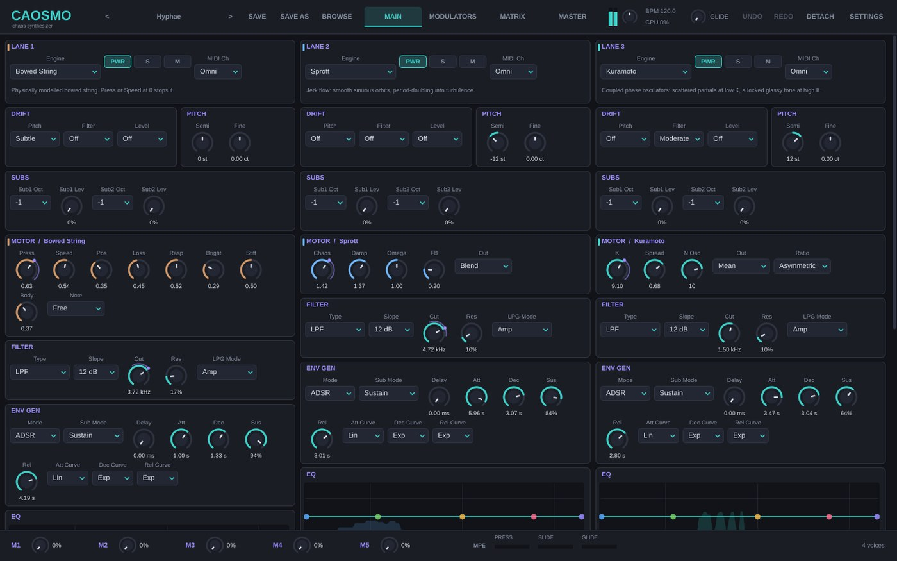
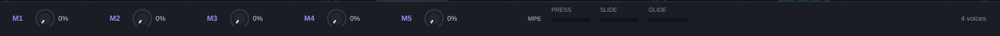
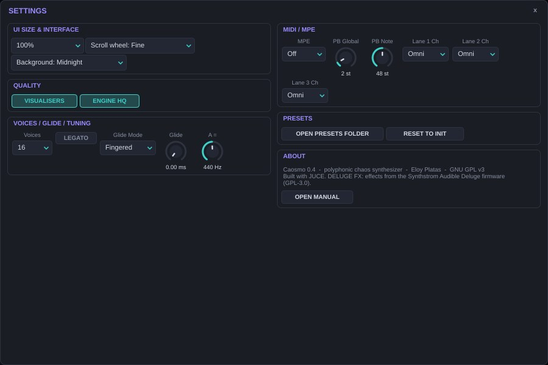
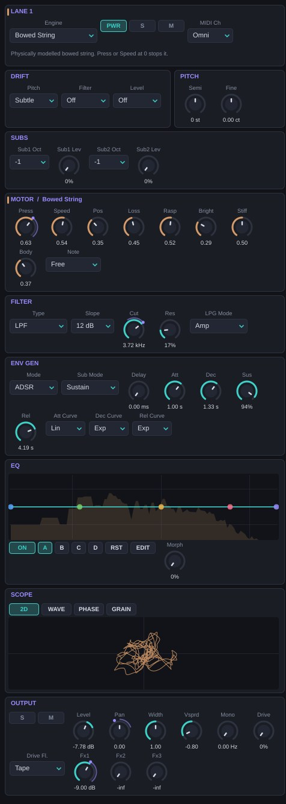

# Introducción {#intro}

Caosmo es un sintetizador polifónico que no reproduce ondas fijas ni muestras: cada nota pone en marcha un **sistema dinámico** y lo que oyes es la trayectoria de ese sistema, resuelta muestra a muestra. Osciladores que se sincronizan entre sí, muelles no lineales empujados al límite, atractores extraños, mapas iterados, un circuito electrónico caótico, una reacción química en un anillo de células, una cuerda frotada, un bucle de retardo con memoria y un mapa que engrana frecuencias como dientes de un engranaje.

El resultado es un instrumento que se comporta más como un objeto físico que como un oscilador: tiene zonas de calma y zonas de turbulencia, responde de forma distinta según cómo llegues a un ajuste, y nunca suena exactamente igual dos veces.

## Qué ofrece {#intro-que}

| Bloque | Contenido |
| --- | --- |
| Voces | Hasta 64 voces. Cada nota suena por **3 capas** independientes. |
| Motores | **12 sistemas caóticos** más *None* para apagar una capa. |
| Por capa | 2 subosciladores, drift analógico, filtro de 12 tipos, envolvente con 4 modos (ADSR, Vactrol, LFO, VENV), EQ de 5 bandas con 4 snapshots y morph, drive con 5 caracteres, 3 envíos. |
| Modulación | 8 LFOs enlazables, 4 envolventes dibujables (VENV), 4 atractores, matriz de 24 rutas, keytrack dibujable, 5 macros, MIDI learn y MPE. |
| Master | EQ con analizador, saturador, compresor con sidechain, width y limitador true-peak. |
| Efectos | 3 buses con 3 ranuras (6 efectos) y el rack **DELUGE FX** con los efectos del firmware abierto del Synthstrom Audible Deluge. |
| Presets | 256 de fábrica en 17 categorías, con etiquetas, favoritos y búsqueda. |
| Formatos | VST3 y aplicación standalone para Linux, Windows y macOS (universal). |

## Origen {#intro-origen}

Caosmo es una reimplementación funcional del concepto descrito en la documentación pública de **Fragua**, de Pura Belia: un sintetizador de caos de tres capas por nota con doce motores. Todo el código, los nombres, la interfaz, los presets y este manual son propios; no contiene código ni recursos de Fragua. Es una obra independiente sin relación con Pura Belia.

## Novedades de la versión 0.4 {#intro-novedades}

- Rack **DELUGE FX** con Mod FX, EQ, destrucción, delay, tres reverbs, compresor y stutter del firmware del Deluge.
- Caosmo pasa a distribuirse bajo la **GNU GPL v3**.
- Binarios para **Windows y macOS** además de Linux, compilados y validados automáticamente.
- Latencia constante de 1,5 ms (el DAW ya no ve saltos al activar el limitador).
- Corrección: el Mod FX del Deluge podía bloquear el plugin al subir Depth desde 0.

## Requisitos {#intro-req}

- Un DAW compatible con **VST3** (REAPER, Bitwig, Ableton Live, Cubase, Studio One, Ardour…) o la versión standalone. Logic Pro no carga VST3: en Mac úsalo en otro DAW o en standalone.
- Linux x86-64 (glibc 2.35 o posterior, p. ej. Ubuntu 22.04), Windows 10/11 de 64 bits o macOS 10.15 o posterior (Intel o Apple Silicon).
- Una CPU moderna: cada capa resuelve ecuaciones diferenciales por muestra. Lee el capítulo de rendimiento antes de pedir 64 voces con tres capas.

# Instalación {#instalacion}

Cada paquete contiene el plugin `Caosmo.vst3`, la versión standalone, la licencia y el manual. Los 256 presets van dentro del plugin: no hay que copiar nada más.

| Sistema | Copia `Caosmo.vst3` en | Standalone |
| --- | --- | --- |
| Linux | `~/.vst3/` (solo tu usuario) o `/usr/lib/vst3/` (todo el sistema) | `Caosmo-standalone` |
| Windows | `C:\Program Files\Common Files\VST3\` | `Caosmo.exe` |
| macOS | `~/Library/Audio/Plug-Ins/VST3/` o `/Library/Audio/Plug-Ins/VST3/` | `Caosmo.app` |

Después vuelve a escanear los plugins en el DAW. En REAPER: *Options → Preferences → Plug-ins → VST → Re-scan*. Caosmo aparece como instrumento del fabricante **Eloy Platas**.

## macOS y Gatekeeper {#inst-mac}

El binario es universal y lleva firma *ad hoc*, no un certificado de desarrollador de Apple. Si macOS dice que el plugin «está dañado» o «no se puede abrir», quita la marca de cuarentena desde Terminal:

```
xattr -dr com.apple.quarantine ~/Library/Audio/Plug-Ins/VST3/Caosmo.vst3
xattr -dr com.apple.quarantine /Applications/Caosmo.app
```

## Windows {#inst-win}

Copiar en `Common Files\VST3` pide permisos de administrador. Si tu DAW no lo encuentra, comprueba que esa carpeta está en su lista de rutas VST3. La versión standalone abre *Options → Audio/MIDI Settings* para elegir dispositivo; con ASIO obtendrás la menor latencia.

## Archivos del usuario {#inst-archivos}

| Qué | Dónde |
| --- | --- |
| Presets de usuario (`.caosmo`) | `Documentos/Caosmo Presets/User` |
| Formas VENV de usuario | `Documentos/Caosmo Presets/VENV` |
| Favoritos y preferencias de interfaz | Ajustes de la aplicación (por usuario) |

«Documentos» es `~/Documents` en Linux y macOS y la carpeta Documentos de tu perfil en Windows. Los presets son archivos de texto XML: puedes compartirlos y versionarlos.

## Compilar desde el código {#inst-compilar}

Caosmo es software libre (GPL v3). Para compilarlo necesitas CMake 3.22+, un compilador con C++23 (GCC 13, Clang 16, AppleClang 15 o clang-cl de Visual Studio 2022) y JUCE 8.0.4:

```
git clone https://github.com/eloyplatas/CAOSMO-VST-linux-osx-windows.git caosmo
git clone --depth 1 --branch 8.0.4 https://github.com/juce-framework/JUCE.git JUCE
cd caosmo
cmake -B build -DCMAKE_BUILD_TYPE=Release -DCAOSMO_TESTS=OFF
cmake --build build --config Release
```

En Windows añade `-A x64 -T ClangCL` al primer `cmake`: el código del Deluge usa extensiones de GCC/Clang que MSVC no admite. En Linux hacen falta las cabeceras de desarrollo de ALSA, X11, Freetype y fontconfig. El repositorio compila las tres plataformas en GitHub Actions en cada cambio y deja los paquetes en la rama `builds`.

# El caos para músicos {#caos}

No hace falta saber matemáticas para tocar Caosmo, pero cinco ideas te ahorrarán mucho tiempo.

## Sistemas dinámicos {#caos-sistemas}

Un sistema dinámico es un conjunto de variables (posición, velocidad, temperatura, fase…) y una regla que dice cómo cambian en el tiempo. Un oscilador sinusoidal es el sistema dinámico más aburrido posible: da vueltas en círculo para siempre. Los motores de Caosmo son sistemas con **no linealidades**: términos al cubo, valores absolutos, saturaciones, productos entre variables. Esas no linealidades son las que permiten comportamientos complejos.

## Atractores {#caos-atractores}

Si dejas correr un sistema con rozamiento, su estado acaba en una región concreta: el **atractor**. Puede ser un punto (el sistema se para: silencio), un ciclo (el sistema repite una forma: un tono periódico), un toro (dos ciclos superpuestos: un tono con batidos) o un **atractor extraño** (el sistema nunca se repite pero nunca se escapa: un sonido vivo, rugoso o ruidoso). Los retratos de fase del SCOPE muestran literalmente el atractor de cada capa.

## Sensibilidad a las condiciones iniciales {#caos-sensibilidad}

En un sistema caótico, dos estados casi idénticos se separan exponencialmente. Por eso Caosmo inicia cada nota con una **semilla distinta**: dos notas iguales seguidas no son idénticas, y un acorde no suena como copias transportadas. Si quieres repetibilidad, varios motores tienen el menú **Note → Free**, que conserva el estado entre notas en lugar de reiniciarlo.

## Bifurcaciones {#caos-bifurcaciones}

Al mover un parámetro de control (K, Gamma, Chaos, Alpha, Sharp, R…) el tipo de atractor puede cambiar de golpe: un tono se desdobla en su suboctava (*duplicación de periodo*), aparece un batido, o el sonido se rompe en ruido. Esos puntos son **bifurcaciones**. Son el mejor material del instrumento: modula lentamente alrededor de ellas con una VENV o un LFO y oirás el sistema decidir. Muchas fronteras tienen **histéresis**: el punto donde el sistema se rompe al subir no coincide con el punto donde se recompone al bajar.

## Sincronización y enganche {#caos-sincronizacion}

Varios motores (Kuramoto, Circle Map, Mackey-Glass) tratan de **engancharse**: osciladores que acaban latiendo juntos, frecuencias que se quedan atrapadas en proporciones simples (1:1, 2:3, 3:4). Entre zonas de enganche hay regiones cuasiperiódicas y caóticas. Ahí está el carácter metálico, vocal o tembloroso de esos motores.

## Cómo protege Caosmo al sistema {#caos-proteccion}

Un sistema no lineal puede escaparse al infinito. Cada motor vigila su estado: si una variable se dispara o deja de ser un número válido, el motor se reinicia en silencio en una posición segura. Oirás como mucho un pequeño clic, nunca una explosión de nivel. Además, todos los motores con altura limitan su paso de integración para mantenerse estables en las notas agudas.

# Arquitectura y flujo de señal {#arquitectura}

<div class="figure">SIGNALFLOW</div>

Cada nota que tocas reserva una **voz**. Dentro de la voz, cada capa con motor tiene su propia cadena completa:

1. **Motor**: genera la señal resolviendo su sistema, afinado a la nota si es un motor con altura.
2. **Sub 1** (otra instancia del mismo motor, 1–3 octavas abajo) y **Sub 2** (seno 1–2 octavas abajo) se suman al motor.
3. **Filtro** de 12 tipos.
4. **Envolvente** (VCA, y en modo LPG también el filtro), escalada por la velocidad.

Después las voces de cada capa se suman en el **bus de la capa**, donde se aplican **EQ**, **drive**, **width**, **bass mono**, **pan**, **nivel** y los **envíos** a los buses FX A–C. Los buses de capa y los retornos de FX se suman, pasan por el rack **DELUGE FX** (si está activo) y por la **cadena master**.

Esta división importa para la modulación: lo que ocurre dentro de la voz (pitch, filtro, motor, envolvente, nivel) puede modularse **por nota**; lo que ocurre en el bus de la capa (EQ, drive, width, pan, envíos) solo puede modularse con **fuentes globales**, porque ahí ya no existen notas separadas.

## Voces y robo de voces {#arq-voces}

**Voices** fija la polifonía máxima (1, 4, 8, 16, 32 o 64). Cuando se agotan, Caosmo roba primero una voz libre, después la voz soltada más antigua y en último caso la más antigua sonando. Con **Voices = 1** el sinte es monofónico: con **Legato** activo las notas ligadas no reinician las envolventes y **Glide** desliza la altura (*Fingered*: solo al ligar; *Always*: siempre).

## Semilla por nota {#arq-semilla}

Cada nota recibe un número aleatorio propio que usan los motores para su estado inicial, el drift, la fuente *Note Random* y el reparto estéreo de Voice Spread. Por eso un mismo preset tiene «vida» sin necesidad de modulación.

# La interfaz {#interfaz}

La ventana mide 1440 × 900 puntos al 100 % y puede escalarse del 75 al 200 % en *Settings*. Las páginas largas se desplazan con la rueda o la barra lateral.



## Barra superior {#ui-barra}


- **< nombre del preset >**: clic en el nombre para abrir el navegador; las flechas cargan el anterior y el siguiente de la lista filtrada.
- **SAVE / SAVE AS / BROWSE**: guardar sobre el preset de usuario actual, guardar como uno nuevo y abrir el navegador.
- **MAIN, MODULATORS, MATRIX, MASTER**: las cuatro páginas.
- **Medidor, volumen de salida, BPM y CPU**: nivel de salida, Output Gain, tempo del host y carga del motor de audio.
- **GLIDE**: tiempo de portamento.
- **UNDO / REDO**: deshacer y rehacer.
- **DETACH**: abre la página actual en una ventana flotante, útil con dos pantallas.
- **SETTINGS**: ajustes, presets y créditos.

## Barra inferior {#ui-inferior}



Las **macros M1–M5**, los medidores **MPE** de la última nota (PRESS, SLIDE, GLIDE) y el número de voces sonando.

## Las cuatro páginas {#ui-paginas}

| Página | Contenido |
| --- | --- |
| MAIN | Las tres capas en columnas: LANE, DRIFT, PITCH, SUBS, MOTOR, FILTER, ENV GEN, EQ, SCOPE y OUTPUT. |
| MODULATORS | 8 LFOs, 4 VENV con su editor y 4 atractores con su retrato 3-D. |
| MATRIX | Las 24 rutas, el editor de KEYTRACK y la vista MACROS. |
| MASTER | Pestañas CHAIN (cadena master y medidores), FX (buses A–C) y DELUGE (rack del Deluge). |

## Trabajar con los controles {#ui-controles}

- **Arrastrar** cambia el valor; **Shift + arrastrar** hace ajuste fino.
- **Doble clic** abre la entrada numérica.
- **Rueda**: ajuste según *Settings* (Fine, Coarse u Off, para no mover nada al desplazarte).
- **Clic derecho**: menú del control con *Modulate with…* (elige una fuente y crea la ruta), *Send to Macro*, *Connected* (lista y borra las rutas que llegan al control), *MIDI / MPE → MIDI Learn*, valor por defecto y entrada numérica.
- **Halo de modulación**: el arco violeta alrededor del control muestra el rango que cubren sus rutas; el punto brillante es el valor modulado en ese instante (de la última nota tocada en destinos por nota).

## Menús de contenedor {#ui-contenedor}

El título de cada bloque (FILTER, ENV GEN, LFO 3…) es un menú:

- **Copy / Paste**: copia los ajustes del bloque; *Paste with routes* incluye las rutas de modulación que llegan a él.
- **Vary**: mueve cada valor al azar hasta un ±15 %. Perfecto para variaciones de un sonido que ya funciona.
- **Randomise**: valores completamente aleatorios dentro de rangos útiles.
- **Copy to Lane** (solo en LANE): copia la capa entera a otra capa.

## Deshacer {#ui-deshacer}

Ctrl + Z / Ctrl + Shift + Z (Cmd en Mac) deshacen y rehacen cambios de parámetros, rutas, formas VENV y keytrack.

## Settings {#ui-settings}



| Sección | Ajuste | Qué hace |
| --- | --- | --- |
| UI Size & Interface | Tamaño | 75–200 % de la interfaz. |
| | Scroll wheel | Fine, Coarse u Off (para no mover controles al desplazarte). |
| | Background | Midnight o Graphite. |
| Quality | VISUALISERS | Activa o pausa scopes y visualizadores (ahorra CPU de interfaz). |
| | ENGINE HQ | Sobremuestreo ×2 en los motores que lo usan (Lorenz Additive). |
| Voices / Glide / Tuning | Voices, Legato, Glide Mode, Glide, A = | Polifonía, legato, portamento y afinación de referencia (415–466 Hz). |
| MIDI / MPE | MPE, PB Global, PB Note | Modo MPE y rangos de pitch bend global y por nota. |
| | Lane 1–3 Ch | Canal MIDI de cada capa (el mismo ajuste que en LANE). |
| Presets | OPEN PRESETS FOLDER | Abre la carpeta de presets en el explorador. |
| | RESET TO INIT | Sustituye el patch por el inicial. |
| About | OPEN MANUAL | Versión, licencia y este manual. |

Las preferencias de interfaz (tamaño, rueda, fondo, visualizadores) son tuyas y no se guardan en los presets.

# Las capas {#capas}



Caosmo tiene tres capas idénticas (L1, L2, L3). Cada nota suena por todas las capas que tengan motor y estén encendidas. Puedes usarlas como tres sintes apilados, como un sonido y sus subcapas, o separarlas por canal MIDI para un *split* o un multitímbrico sencillo.

## LANE {#capas-lane}

| Parámetro | Rango (defecto) | Qué hace |
| --- | --- | --- |
| Engine | None + 12 motores (L1 Kuramoto, L2 y L3 None) | Motor de la capa. Los ajustes de los 12 motores se conservan: puedes cambiar de motor y volver sin perder nada. |
| PWR | On/Off (On) | Apaga la capa: deja de calcularse y sus envolventes dejan de modular. |
| S / M | Solo / Mute | Aíslan o silencian la capa sin dejar de calcularla (sus fuentes siguen modulando). |
| MIDI Ch | Omni, 1–16 (Omni) | Canal que dispara la capa. Con MPE activo se ignora. |

## DRIFT {#capas-drift}

Cada nota recibe al nacer una desviación aleatoria fija, como las tolerancias de un sintetizador analógico. No cambia durante la nota.

| Nivel | Pitch | Filter | Level |
| --- | --- | --- | --- |
| Off | 0 | 0 | 0 |
| Subtle | ±3 cents | ±1 semitono | ±0,5 dB |
| Moderate | ±8 cents | ±3 semitonos | ±1,5 dB |
| Heavy | ±20 cents | ±7 semitonos | ±3 dB |

*Subtle* en las tres capas engorda un acorde sin desafinarlo; *Heavy* en pitch da coros desafinados de cinta vieja.

## PITCH {#capas-pitch}

**Pitch** transpone ±36 semitonos y **Fine** ±100 cents. Ambos son destinos de modulación por nota: un LFO lento en Fine da vibrato; una VENV en Pitch, barridos de altura. En los motores sin altura (Lorenz+Rossler, Logistic/Henon, Gray-Scott sin BPF) Pitch solo afecta a los subosciladores y a los filtros que siguen la nota.

## SUBS {#capas-subs}

| Parámetro | Rango (defecto) | Qué hace |
| --- | --- | --- |
| Sub1 Oct | −1, −2, −3 oct (−1) | Octava del Sub 1. |
| Sub1 Lev | 0–100 % (0) | **Una segunda instancia del mismo motor**, con los mismos ajustes, tocando 1–3 octavas abajo. Engorda sin perder el carácter. Duplica el coste de CPU del motor. |
| Sub2 Oct | −1, −2 oct (−1) | Octava del Sub 2. |
| Sub2 Lev | 0–100 % (0) | Un **seno puro** con un detune estéreo de unos ±3 cents. Da fundamental a motores ruidosos o sin altura. Coste casi nulo. |

Los dos subs pasan por el mismo filtro y envolvente que el motor.
