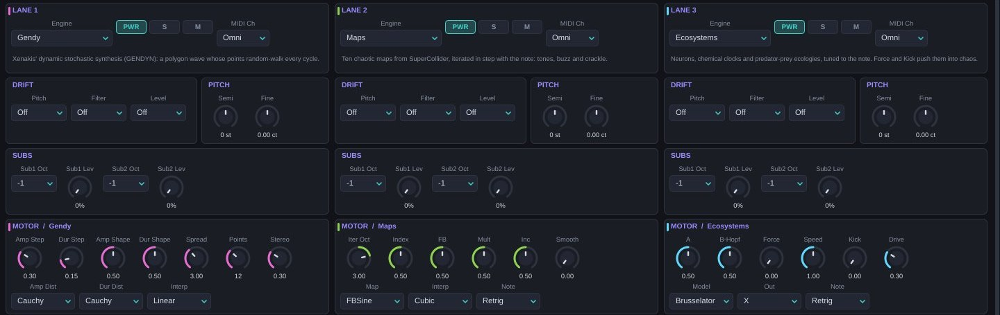
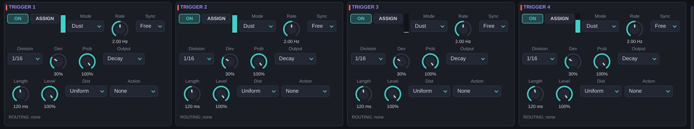
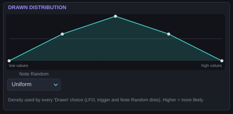

# Los motores de SuperCollider {#motores-sc}

La versión 0.5 añade cinco motores (13–17) que vienen de estudiar la documentación de **SuperCollider**, el lenguaje de síntesis de código abierto. Son reimplementaciones de sus generadores (UGens) de caos y azar, adaptadas a la arquitectura de Caosmo: cada uno sigue la nota, recibe su semilla por nota y ofrece sus seis primeros parámetros como destinos *Motor 1–6* de la matriz.

| # | Motor | Altura | Carácter | CPU |
| --- | --- | --- | --- | --- |
| 13 | Gendy | Sí | Síntesis estocástica de Xenakis: timbres que se reescriben en cada ciclo | Baja |
| 14 | Maps | Sí | Diez mapas caóticos de SuperCollider iterados al ritmo de la nota | Muy baja |
| 15 | Ecosystems | Sí | Neuronas, relojes químicos y poblaciones de presa y depredador | Baja |
| 16 | Noise | No (sí con Key BPF) | Ruidos clásicos y caóticos: rosa, marrón, gris, Crackle, Dust | Muy baja |
| 17 | Membrane | Sí | Una pelota que rebota sobre una membrana, barra o campana | Media |

Con 8 notas y tres capas, cada uno de estos motores usa entre el 5 y el 13 % de un núcleo.

## Gendy {#m-gendy}

**El sistema.** La *síntesis estocástica dinámica* (GENDYN) de **Iannis Xenakis**, en la versión Gendy1 de Nick Collins. La onda es un polígono de N puntos. En cada ciclo cada punto da un paso aleatorio en amplitud y en duración, con un tamaño elegido de una distribución de probabilidad. Las barreras reflejan los pasos para que el polígono no se escape. El resultado tiene una altura reconocible pero un timbre que nunca se repite.

**En Caosmo.** La duración total del polígono se ajusta a la nota; *Spread* deja que cada segmento se desvíe unos semitonos. Dos generadores independientes alimentan los canales izquierdo y derecho.

| Parámetro | Rango (defecto) | Qué hace |
| --- | --- | --- |
| Amp Step | 0–1 (0,3) | Tamaño de los pasos de amplitud. Bajo: casi estático. Alto: ruido rugoso. |
| Dur Step | 0–1 (0,15) | Tamaño de los pasos de duración: cuánto vibra y se desafina el ciclo. |
| Amp Shape | 0–1 (0,5) | Parámetro de la distribución de amplitud (la forma de la campana, de la cola…). |
| Dur Shape | 0–1 (0,5) | Lo mismo para la distribución de duración. |
| Spread | 0–24 st (3) | Desviación máxima de cada segmento respecto a la nota. |
| Points | 2–32 (12) | Puntos del polígono. Pocos: tonos ásperos y brillantes. Muchos: timbres más finos. |
| Stereo | 0–1 (0,3) | Diferencia entre los dos generadores: 0 mono, 1 dos voces distintas. |
| Amp Dist / Dur Dist | Linear, Cauchy, Logist, Hyperbcos, Arcsine, Expon, Sinus (Cauchy) | Distribución de los pasos. Cauchy tiene colas largas: casi siempre pasos pequeños y de vez en cuando uno enorme. *Sinus* toma los pasos de un seno interno. |
| Interp | Linear, Cubic (Linear) | Cómo se unen los puntos. Cubic suaviza las esquinas. |

**Puntos dulces.** Amp Step 0,1–0,2 con Dur Step 0,05: un coro que respira (*Xenakis Choir*). Points 6 y los dos pasos por encima de 0,5: el sonido áspero de *S709*. *Hyperbcos* da un nivel más bajo que las demás distribuciones: compensa con Level.

## Maps {#m-mapszoo}

**El sistema.** La familia *ChaosGen* de SuperCollider: diez mapas iterados, cada uno una regla que calcula el siguiente valor a partir del actual.

**En Caosmo.** El mapa se itera a la frecuencia de la nota multiplicada por 2^Iter Oct. Entre iteraciones la salida se mantiene (Step), se interpola en línea recta (Linear) o con una curva Catmull-Rom (Cubic): son los sufijos N, L y C de SuperCollider. Con Iter Oct bajo oyes cada iteración como parte de la forma de onda; con Iter Oct alto el mapa produce un timbre agudo sobre la nota. Los parámetros A–D cambian de significado según el mapa; las etiquetas de la interfaz se actualizan solas. Con A–D al 50 % cada mapa usa los valores por defecto de SuperCollider.

| Mapa | A | B | C | D | Carácter |
| --- | --- | --- | --- | --- | --- |
| Latoocarfian | a | b | c | d | Del libro de Pickover: tonos, ciclos o caos según los cuatro parámetros. |
| Standard | K | — | — | — | Mapa de Chirikov. K por debajo de 1: zumbido casi periódico. Por encima: se rompe. |
| Gingerbread | X0 | Y0 | — | — | El «hombre de jengibre»: solo dependen las condiciones iniciales, que reinician el mapa al moverse. |
| Cusp | a | b | — | — | Picos afilados, timbre de lengüeta. |
| Quad | a | b | c | — | Mapa cuadrático general. |
| LinCong | Mult | Inc | Mod | — | Generador congruencial lineal: escaleras digitales de 8 bits. |
| FBSine | Index | FB | Mult | Inc | Un seno cuya fase avanza por un congruencial. Index 0,5, FB 0 y Mult 0,25 dan un seno puro. |
| Crackle | Param | — | — | — | El mapa de Crackle: crepitar cerca del colapso. |
| Logistic | R | — | — | — | El mapa logístico, con altura. |
| Henon | A | B | — | — | El mapa de Hénon, con altura. |

| Parámetro | Rango (defecto) | Qué hace |
| --- | --- | --- |
| Iter Oct | −2 – 7 (3) | Iteraciones por ciclo de la nota, en octavas: 3 = 8 iteraciones por ciclo. |
| A, B, C, D | 0–1 (0,5) | Parámetros del mapa (ver tabla). |
| Smooth | 0–1 (0) | Paso bajo con compensación de nivel. |
| Map | Los 10 mapas (Latoocarfian) | Sistema. |
| Interp | Step, Linear, Cubic (Cubic) | Interpolación entre iteraciones. |
| Note | Retrig, Free (Retrig) | Retrig reinicia el mapa en cada nota; Free lo deja seguir. |

**Logistic/Henon también sigue la nota.** El motor 5 tiene un parámetro nuevo, *Clock*. *Per Sample* es el comportamiento de siempre (una iteración por muestra, ruido sin altura). *Note Step*, *Note Linear* y *Note Cubic* lo iteran como Maps, a la nota por 2^*Iter Oct*: el ruido granular se convierte en un tono afinado.

## Ecosystems {#m-eco}

**El sistema.** Seis modelos de la biología y la química, tomados de los SLUGens de Nick Collins y los ChaosUGens de Till Bovermann:

- **FitzHugh-Nagumo**: una neurona simplificada. Por debajo de un umbral de corriente no hace nada; por encima, dispara picos regulares.
- **Brusselator**: un reloj químico teórico. Por encima de la bifurcación de Hopf oscila en un ciclo límite.
- **Oregonator**: el modelo de la reacción de Belousov-Zhabotinsky, el famoso cóctel químico que cambia de color en ciclos.
- **Lotka-Volterra**: presas y depredadores. Cuando hay muchas presas crecen los depredadores, que luego se las comen.
- **Arneodo-Coullet-Tresser**: tres especies en competencia; tiene un atractor caótico.
- **Spruce Budworm**: brotes de una plaga forestal, iterado como mapa.

**En Caosmo.** Las ecuaciones se integran con Runge-Kutta de 4.º orden. Un detector de periodo mide la oscilación y ajusta la velocidad para que suene a la altura de la nota, aunque P1 y P2 cambien el periodo natural del sistema. *Force* añade un forzamiento sinusoidal a la nota y *Kick* golpes de ruido: los dos empujan el sistema fuera de su ciclo hacia el caos.

| Modelo | P1 | P2 |
| --- | --- | --- |
| FitzHugh-Nagumo | Current: corriente de entrada | Eps: velocidad de recuperación |
| Brusselator | A | B-Hopf: distancia a la bifurcación |
| Oregonator | F: estequiometría | Eps: separación de escalas |
| Lotka-Volterra | Prey: crecimiento de las presas | Pred: muerte de los depredadores |
| Arneodo-Coullet-Tresser | Alpha | Immig: inmigración |
| Spruce Budworm | Step: paso del mapa | K1: capacidad del bosque |

| Parámetro | Rango (defecto) | Qué hace |
| --- | --- | --- |
| P1, P2 | 0–1 (0,5) | Parámetros del modelo (ver tabla). Las etiquetas cambian con el modelo. |
| Force | 0–1 (0) | Forzamiento periódico a la frecuencia de la nota. |
| Speed | 0,25–4 (1) | Multiplica la velocidad: cambia el timbre sin cambiar la nota a la que se afina. |
| Kick | 0–1 (0) | Impulsos de ruido que sacan al sistema de su órbita. |
| Drive | 0–1 (0,3) | Saturación de la salida. |
| Model | Los 6 modelos (FitzHugh-Nagumo) | Sistema. |
| Out | X, Y, Z, Blend (X) | Variable que se escucha (Z solo existe en ACT). |
| Note | Retrig, Free (Retrig) | Retrig reinicia el sistema en cada nota; Free lo deja seguir. |

**Puntos dulces.** FitzHugh-Nagumo con P1 cerca del centro y un poco de Kick: una neurona que a veces falla (*Spiking Neuron*). En los extremos de P1 la neurona se queda quieta y la capa calla: sube Kick para despertarla. Brusselator con Force 0,35: entra y sale de su ciclo (*Brusselator Pad*).

## Noise {#m-noise}

**El sistema.** Los generadores de ruido de SuperCollider: WhiteNoise, PinkNoise (algoritmo de Voss-McCartney), BrownNoise, GrayNoise (un bit de un registro que cambia al azar), ClipNoise, Crackle y los impulsos Dust y Dust2.

| Parámetro | Rango (defecto) | Qué hace |
| --- | --- | --- |
| Tone | −1 – 1 (0) | Inclinación espectral: oscuro a brillante. |
| Density | 1–20 000 /s (300) | Impulsos por segundo de Dust y Dust2. |
| Chaos | 1–2,05 (1,9) | Parámetro de Crackle. Cerca de 2 crepita; por encima, se rompe en ráfagas. |
| Stereo | 0–1 (0,6) | Decorrelación entre canales. |
| Key BPF | 0–1 (0) | Mezcla de un paso banda afinado a la nota: da altura al ruido. |
| Q | 0,5–30 (6) | Resonancia del paso banda. |
| Type | White, Pink, Brown, Gray, Clip, Crackle, Dust, Dust2 (White) | Generador. |
| Clock | Free, Note Step, Note Smooth (Free) | *Note Step*: muestreo y retención al doble de la nota (ruido «digital» afinado). *Note Smooth*: lo mismo, interpolado. |

**Puntos dulces.** Dust2 con Key BPF 0,8 y Q 18: lluvia afinada (*Dust Devils*). Gray con Note Step y Q 25: un lead de bits (*Gray Code*).

## Membrane {#m-membrane}

**El sistema.** Una pelota que cae y rebota, como el UGen TBall de Dan Stowell, golpeando un cuerpo resonante modal. Cada golpe excita hasta 16 modos con las proporciones de una membrana circular, una placa cuadrada, una barra libre o una campana.

**En Caosmo.** Al pulsar la nota la pelota cae desde *Height*. Cada rebote pierde energía (*Bounce Loss*) y golpea antes, así que los golpes se aceleran hasta que la pelota se para: un redoble que se cierra solo. Una nota nueva golpea el mismo cuerpo, que sigue sonando.

| Parámetro | Rango (defecto) | Qué hace |
| --- | --- | --- |
| Gravity | 0,5–40 (6) | Gravedad. Alta: rebotes rápidos. Baja: golpes lentos y espaciados. |
| Bounce Loss | 0–1 (0,35) | Energía perdida en cada rebote: cuánto dura el redoble. |
| Height | 0–1 (0,5) | Altura inicial: fuerza del primer golpe y tiempo hasta él. |
| Scatter | 0–1 (0,1) | Irregularidad de cada rebote. |
| Decay | 0,02–8 s (0,8) | Caída de los modos. |
| Strike | 0–1 (0,5) | Brillo del golpe: bajo excita los modos graves; alto, los agudos. |
| Tension | 0–1 (0) | Estira las proporciones de los modos: cuerpos más inarmónicos y tensos. |
| Modes | 2–16 (10) | Número de modos. |
| Body | Circle Membrane, Square Membrane, Free Bar, Bell (Circle Membrane) | Cuerpo. |

**Puntos dulces.** Free Bar con gravedad 14: canica sobre xilófono (*Marble Bar*). Bell con gravedad 1,2 y Decay largo: golpes lunares (*Low Gravity*). Un disparo aleatorio enrutado a Scatter cambia cada caída.

# Azar: disparos, distribuciones y ondas nuevas {#azar}

## Disparos aleatorios ×4 {#disparos}

Cuatro generadores de disparos, en los paneles TRIGGER al final de la página MODULATORS. Producen eventos en momentos aleatorios y pueden modular la matriz o actuar directamente sobre el sinte. Vienen de los UGens Dust, GaussTrig, CoinGate y LorenzTrig de SuperCollider.

| Modo | Cómo dispara |
| --- | --- |
| Dust | Proceso de Poisson: Rate eventos por segundo de media, sin ningún patrón. |
| Gauss | Un reloj con el intervalo desviado según una campana de Gauss (Deviation). Un pulso humano. |
| Coin | Un reloj regular; cada golpe pasa solo con la probabilidad indicada. |
| Lorenz | La velocidad instantánea sigue un atractor de Lorenz: ráfagas y silencios. |
| Clock | Reloj regular con swing (Deviation). |

| Parámetro | Rango (defecto) | Qué hace |
| --- | --- | --- |
| On | On/Off (On) | Activa el generador. |
| Mode | Ver tabla (Dust) | Tipo de proceso. |
| Rate | 0,05–50 Hz (2) | Eventos por segundo. Modulable (destino *TrigN Rate*). |
| Sync / Division | Free, Host / divisiones (Free / 1/16) | Ritmo ligado al tempo. |
| Deviation | 0–100 % (30 %) | Desviación de Gauss, amplitud de Lorenz o swing de Clock. |
| Probability | 0–100 % (100 %) | Probabilidad de que cada disparo pase (CoinGate). Modulable (*TrigN Prob*). |
| Output | Gate, Decay, S&H, S&H Decay (Decay) | Señal de la fuente *Trig N*: puerta, caída exponencial, valor aleatorio retenido o valor aleatorio que cae. |
| Length | 1–2000 ms (120) | Duración de la puerta o de la caída. |
| Dist | Las 10 distribuciones (Uniform) | De dónde salen los valores de S&H. |
| Action | None, Retrig Envs, Restart LFOs, Stutter (None) | Qué hace además el disparo: reiniciar las envolventes de las notas que suenan, reiniciar los LFOs con Retrig, o abrir el stutter del Deluge mientras dura la puerta. |
| Level | 0–100 % (100 %) | Amplitud de la fuente. |

Una luz junto a cada generador parpadea con cada disparo.

## Distribuciones {#distribuciones}

Los valores aleatorios de Caosmo ya no tienen que ser uniformes. Diez distribuciones, inspiradas en los patrones Pwhite, Pgauss, Plprand, Phprand, Pmeanrand, Pexprand, Pcauchy, Pbeta, Ppoisson y Pprob de SuperCollider:

| Distribución | Forma |
| --- | --- |
| Uniform | Todos los valores igual de probables. |
| Gauss | Campana centrada: casi siempre cerca del medio. |
| Low / High | Favorece los valores bajos / altos (mínimo o máximo de dos tiradas). |
| Mean | Triangular: media de dos tiradas. |
| Exponential | Muchos valores pequeños, pocos grandes. |
| Cauchy | Casi siempre en el centro, con saltos extremos de vez en cuando. |
| Beta | En forma de U: casi siempre en los extremos. |
| Poisson | Escalones discretos (λ = 4). |
| Drawn | La que dibujes en el editor de la página MATRIX. |

Se eligen en tres sitios: el parámetro *Dist* de cada LFO (para Random S&H, Random Smooth y las ondas nuevas), el *Dist* de cada disparo y *Note Random Dist* en la página MATRIX, que cambia la fuente *Note Random*.

**Distribución dibujada.** El panel DRAWN DISTRIBUTION de la página MATRIX es un editor de curva como el de keytrack: dibuja la densidad de probabilidad (más alto, más probable) y Caosmo la convierte en una tabla de muestreo. Se guarda con el preset. Por defecto es una campana.

## Ondas de LFO con memoria {#lfo-nuevas}

Cuatro formas nuevas que recuerdan su estado de un ciclo al siguiente. *Skew* controla cuánto se mueven y *Dist* de dónde salen los pasos.

| Onda | Comportamiento |
| --- | --- |
| Brownian | Paseo aleatorio con rebote en los bordes: deriva lenta y orgánica. |
| Geo Brownian | Paseo en escala logarítmica: se mueve en proporción a su valor, como un precio. |
| Noise Ring | El anillo de ruido de Wiard: un registro de 16 bits que gira; Skew decide cuántos bits cambian. Skew bajo repite un patrón, alto lo reescribe. |
| Markov | Cadena de Markov sobre 8 niveles. Skew bajo: pasos a niveles vecinos. Alto: saltos a cualquier sitio. |

Con Loop Lock activado estas ondas se reproducen desde el principio en cada vuelta: azar que se repite exactamente.

# Filtros, atractores y efectos nuevos {#nuevo-05}

## Filtros Friction y Spring {#filtros-nuevos}

| Tipo | Cómo funciona | Res controla |
| --- | --- | --- |
| Friction | Una masa sobre una cinta que se mueve con la señal (Friction de Dan Stowell). Se pega y se suelta: añade rozamiento y chirrido. Cutoff es la frecuencia del muelle. Suena más fuerte con Cutoff bajo (100–500 Hz). | Fricción seca: cuánto se pega |
| Spring | Masa y muelle no lineal (endurecido, como Duffing) excitados por la señal: resonancia que sube de tono con la amplitud. | Menos amortiguación y más no linealidad |

## Atractores nuevos {#atractores-nuevos}

Los moduladores de atractor tienen siete tipos más:

| Type | P1 | P2 | Carácter |
| --- | --- | --- | --- |
| Henon | A | B | Mapa de Hénon: saltos entre puntos de una curva fractal. |
| Latoocarfian | A | B | Mapa de Pickover: escalones caóticos o ciclos. |
| Standard | K | Init | Mapa de Chirikov: casi periódico con K bajo, caótico con K alto. |
| Gingerbread | X0 | Y0 | Recorrido determinista con zonas de calma. |
| FitzHugh | Current | Eps | Una neurona: picos regulares o silencio. |
| Lotka-Volterra | Prey | Pred | Ciclos de presa y depredador: subidas lentas y caídas bruscas. |
| ACT | Alpha | Immig | Tres especies en competencia, caótico. |

Los cuatro primeros son mapas: dan un paso por cada ciclo de Rate y Smooth une los pasos.

## Efectos espectrales y de ciclo {#fx-nuevos}

Seis efectos nuevos para las ranuras de los buses. Los cuatro primeros trabajan sobre el espectro (FFT de 1024 puntos, 21 ms de latencia interna dentro del bus), como los PV_ de SuperCollider.

| Efecto | P1 | P2 | P3 | P4 | Option |
| --- | --- | --- | --- | --- | --- |
| Diffuse | Amount | Rate (0,05–20 Hz) | Level | — | Live / Freeze |
| Mag Noise | Amount | Smooth | Level | — | — |
| Rand Comb | Density | Rate (0,05–20 Hz) | Smear | Level | Live / Freeze |
| Noise Synth | Thresh | Memory (1–16 tramas) | Level | — | Unstable / Stable |
| Wave Loss | Drop | Burst (1–16 ciclos) | Level | — | Random / Regular |
| Squiz | Ratio (1–10×) | Cycles (1–10) | Level | — | — |

- **Diffuse** (PV_Diffuser): desordena la fase de cada banda; *Rate* cambia el desorden con el tiempo. *Freeze* congela el espectro con fases aleatorias: un sostenido infinito.
- **Mag Noise** (PV_MagNoise): multiplica la amplitud de cada banda por ruido; *Smooth* lo hace lento y ondulante.
- **Rand Comb** (PV_RandComb): apaga bandas al azar; *Density* es la proporción que pasa, *Smear* suaviza los cambios. *Freeze* fija la selección.
- **Noise Synth** (PV_NoiseSynth): separa las bandas estables (tonos) de las inestables (ruido). *Unstable* deja solo el ruido; *Stable*, solo los tonos.
- **Wave Loss**: elimina ciclos de onda completos entre pasos por cero; *Drop* es la proporción, *Burst* cuántos ciclos seguidos.
- **Squiz**: reproduce cada grupo de ciclos más rápido, «apretándolo» hacia arriba: un pitch shifter crudo y granulado.

Para que el nivel no cambie al cambiar de efecto, Level al 62,5 % equivale a ganancia unidad en los cuatro espectrales.
