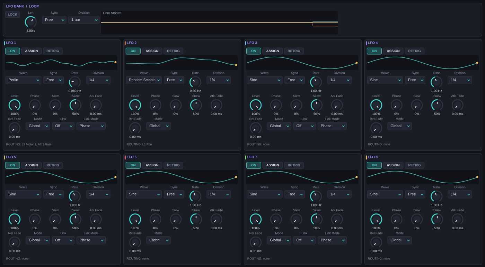
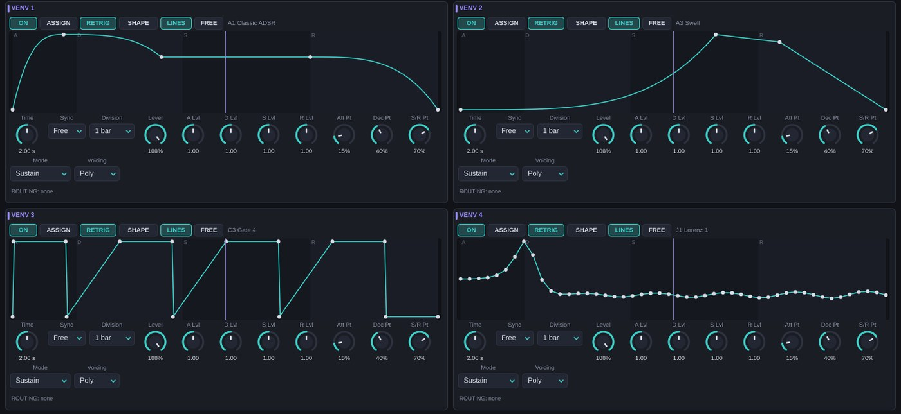
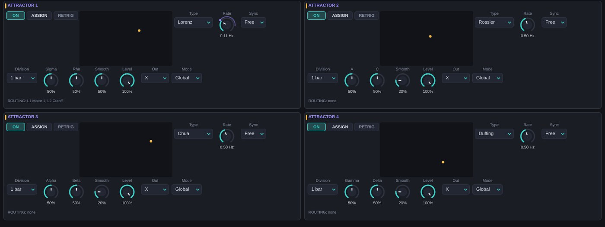
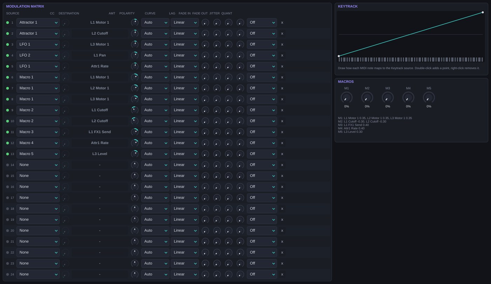
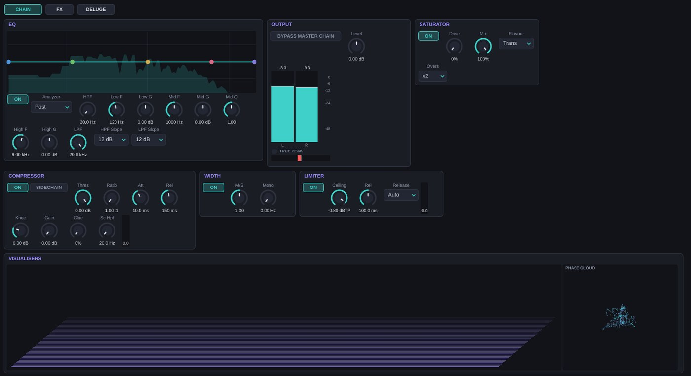
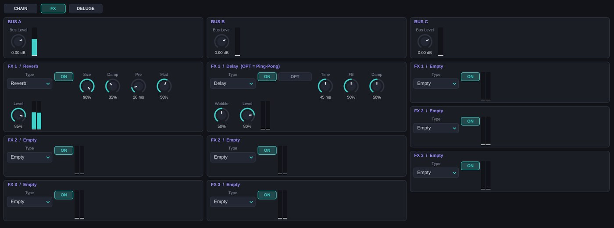
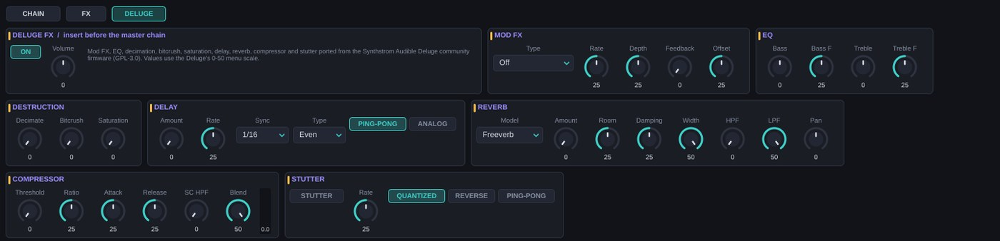

# Filtro, envolvente, EQ y salida {#cadena}

## FILTER {#filtro}

Cada capa tiene un filtro estéreo por voz con doce tipos. Los filtros de estado variable (SVF, diseño de Simper) se mantienen estables aunque modules el corte a velocidad de audio.

| Tipo | Cómo funciona | Res controla |
| --- | --- | --- |
| LPF | Paso bajo SVF en cascada | Resonancia de la última etapa |
| HPF | Paso alto SVF en cascada | Resonancia |
| BPF | Paso banda de ganancia unidad | Estrechez de la banda |
| Notch | Banda eliminada | Estrechez |
| Peak | Campana a la frecuencia de corte | Ganancia, hasta +18 dB |
| Low Shelf | Estante de graves | Ganancia, hasta +18 dB |
| High Shelf | Estante de agudos | Ganancia, hasta +18 dB |
| All-Pass | Cambia la fase sin cambiar el nivel; útil modulado | Agudeza del giro de fase |
| Ladder | Escalera de 4 polos (24 dB/oct) con saturación de entrada, estilo transistor | Realimentación hasta la autooscilación |
| Comb | Filtro peine: un retardo de 1/corte con realimentación. Afinado a Cutoff, no a la nota | Realimentación (hasta 0,97) |
| Formant | Tres bandas en las frecuencias de las vocales; Cutoff recorre A → E → I → O → U | Estrechez de los formantes |
| Phaser | Cuatro pasatodos escalonados mezclados con la señal directa | Realimentación |

| Parámetro | Rango (defecto) | Qué hace |
| --- | --- | --- |
| Filter Type | Los 12 tipos (LPF) | Tipo. |
| Filter Slope | 12, 24, 36, 48 dB (12) | Número de etapas en LPF, HPF, BPF, Notch y All-Pass. Los demás tipos tienen pendiente fija. |
| Cutoff | 20 Hz – 20 kHz (20 kHz) | Corte o centro. Modulable por nota. |
| Res | 0–100 % (10 %) | Ver tabla anterior. |
| LPG Mode | Amp, Amp + Filt (Amp) | *Amp + Filt*: la envolvente también abre el filtro, como un *low pass gate* de Buchla. El corte real va de 20 Hz (envolvente a 0) hasta Cutoff (envolvente a 1). |

Para afinar el filtro a la nota, crea una ruta *Keytrack → Cutoff*. Comb con la ruta de keytrack y Res alta convierte cualquier motor sin altura en una cuerda pulsada.

## ENV GEN {#envolvente}

Una envolvente por capa y por nota controla el volumen (y el filtro en modo LPG). Su salida también es la fuente *Lane Env* de la matriz. Tiene cuatro modos:

**ADSR.** Envolvente clásica con retardo y curvas por tramo.

**Vactrol.** Simula un optoacoplador (una lámpara frente a una fotorresistencia), el corazón de los *low pass gates*. Tiene dos componentes, una rápida y una lenta, cada una con su subida y bajada. La **memoria** imita la fotorresistencia real: cuanto más se ha iluminado recientemente, más tarda en apagarse (hasta cinco veces más). Toca notas rápidas y las colas se alargan solas.

**LFO.** La envolvente es un LFO por nota que empieza en fase 0: trémolos, pulsos, *gates* rítmicos libres.

**VENV.** La envolvente es una de las cuatro formas dibujadas de la página MODULATORS, con un tiempo propio para esta capa.

| Parámetro | Modo | Rango (defecto) | Qué hace |
| --- | --- | --- | --- |
| Env Mode | — | ADSR, Vactrol, LFO, VENV (ADSR) | Modo. |
| Env Sub Mode | Todos | Sustain, One-Shot, Sustain-Loop (Sustain) | *One-Shot*: ignora el final de la nota (percusión). *Sustain-Loop*: en VENV repite la zona de sostenido. |
| Delay | ADSR | 0–2000 ms (0) | Espera antes del ataque. |
| Attack | ADSR | 0,3 ms – 10 s (5 ms) | Subida. Arranca desde el nivel actual: no hay clics al repetir notas. |
| Decay | ADSR | 1 ms – 10 s (300 ms) | Caída hasta Sustain. |
| Sustain | ADSR | 0–100 % (80 %) | Nivel mientras mantienes la nota. |
| Release | ADSR | 1 ms – 15 s (400 ms) | Cola al soltar. |
| Att / Dec / Rel Curve | ADSR | Lin, Exp, Log (Lin / Exp / Exp) | Forma de cada tramo. *Exp* en caídas suena natural. |
| Rise Fast / Fall Fast | Vactrol | 0,5–500 ms (5) / 1–2000 ms (80) | Componente rápida. |
| Rise Slow / Fall Slow | Vactrol | 5–2000 ms (120) / 20–8000 ms (900) | Componente lenta: la cola. |
| Vac Mix | Vactrol | 0–100 % (50 %) | Peso de la componente lenta. |
| Memory | Vactrol | 0–100 % (30 %) | Efecto memoria. |
| Vac Shape | Vactrol | 0–100 % (40 %) | Curvatura de la respuesta de la lámpara: más alto, más «pop» y colas más finas. |
| Vac Drift | Vactrol | 0–100 % (10 %) | Variación aleatoria de tiempos por nota, hasta ±35 %. |
| Env LFO Rate | LFO | 0,05–40 Hz (2) | Velocidad. |
| Env LFO Shape | LFO | Sine, Triangle, Saw Down, Square, Ramp Up (Sine) | Forma. *Saw Down* da pulsos percusivos. |
| Env VENV Shape | VENV | VENV 1–4 (VENV 1) | Forma que se usa. |
| Env VENV Time | VENV | 0,01–30 s (1) | Duración de la forma en esta capa (independiente del Time de la VENV). |

La **velocidad MIDI** siempre escala el nivel de forma lineal. La fuente *Velocity* de la matriz permite además llevarla a cualquier otro destino.

## EQ de capa {#eq}

Un ecualizador estéreo de cinco bandas en el bus de la capa: paso alto, estante de graves, campana media, estante de agudos y paso bajo. En la curva puedes arrastrar los nodos; la rueda cambia la Q de la banda media o la pendiente de los filtros. **EDIT** abre un editor grande.

| Parámetro | Rango (defecto) |
| --- | --- |
| EQ On | On/Off (On) |
| EQ HPF / HPF Slope | 20 Hz – 2 kHz (20) / 12–48 dB (12) |
| EQ Low Freq / Low Gain | 20 Hz – 1 kHz (120) / ±18 dB (0) |
| EQ Mid Freq / Mid Gain / Mid Q | 100 Hz – 10 kHz (1 kHz) / ±18 dB (0) / 0,2–8 (1) |
| EQ High Freq / High Gain | 1–18 kHz (6 kHz) / ±18 dB (0) |
| EQ LPF / LPF Slope | 200 Hz – 20 kHz (20 kHz) / 12–48 dB (12) |

### Snapshots y morph {#eq-morph}

El EQ guarda hasta **cuatro curvas** (snapshots A–D):

1. Ajusta una curva en A.
2. Selecciona B: la primera vez, B copia la curva actual. Modifícala.
3. Repite con C y D si quieres.
4. **EQ Morph** (0–100 %) recorre los snapshots usados en orden A → B → C → D, interpolando frecuencias de forma logarítmica y ganancias de forma lineal.

Al elegir un snapshot el morph se coloca sobre él, para que oigas lo que editas. **RST** vuelve a un único snapshot plano. EQ Morph es un destino de modulación (con fuentes globales): un LFO lento sobre él da filtrados de varias bandas que se mueven a la vez.

## OUTPUT {#salida}

| Parámetro | Rango (defecto) | Qué hace |
| --- | --- | --- |
| Level | −60 – +12 dB (0) | Volumen de la capa. Modulable por nota. |
| Pan | −1 – +1 (0) | Panorama de la capa. |
| Width | 0–2 (1) | Anchura M/S: 0 mono, 1 natural, 2 lados al doble. |
| Voice Spread | −1 – +1 (0) | Coloca cada voz en una posición estéreo fija según el orden de las notas (izquierda, derecha, centro-izquierda…). El signo invierte el lado. Un acorde se abre como una sección. |
| Bass Mono | 0–500 Hz (0 = off) | Por debajo de esta frecuencia la capa es mono. |
| Drive | 0–100 % (0) | Saturación del bus de la capa, con ganancia de hasta ×15 y compensación de nivel. |
| Drive Flavour | Tape, Clip, Fold, Transformer, Wavefolder (Tape) | Ver tabla. |
| FX1 / FX2 / FX3 Send | −60 – 0 dB (−60 = off) | Envío a los buses A, B y C (post-fader). |

| Flavour | Carácter |
| --- | --- |
| Tape | Tangente hiperbólica con asimetría: armónicos pares, cálido, comprime suavemente. |
| Clip | Recorte duro: agresivo, digital. |
| Fold | Plegado sinusoidal: al subir, la onda se dobla sobre sí misma y aparecen armónicos metálicos. |
| Transformer | Saturación con el «hombro» redondeado de un transformador: densa, armónicos impares. |
| Wavefolder | Plegado triangular múltiple, estilo West Coast: muy brillante, cambia de timbre con el nivel de entrada. |

Pan, Width, Drive, los envíos y EQ Morph actúan sobre el bus de la capa, así que solo aceptan modulación de fuentes globales. La matriz marca en rojo una ruta que no puede tener efecto.

# Modulación {#modulacion}

Caosmo tiene 16 moduladores y 24 rutas. Hay dos formas de conectar:

- **ASSIGN**: pulsa ASSIGN en un modulador y haz clic en cualquier control. Esc cancela.
- **Clic derecho → Modulate with…** en el control de destino.

Las dos crean una ruta en la matriz, donde puedes afinar su cantidad, curva y comportamiento.

**Global y Poly.** Un modulador *Global* es una única instancia compartida por todas las notas: perfecto para movimientos de conjunto y para destinos del bus o del master. Un modulador *Poly* tiene una copia independiente por nota, que empieza con la nota: cada voz se mueve por su cuenta.

## LFO ×8 {#lfo}

| Parámetro | Rango (defecto) | Qué hace |
| --- | --- | --- |
| On | On/Off (On) | Activa el LFO. |
| Wave | Sine, Triangle, Saw Up, Saw Down, Pulse, Random S&H, Random Smooth, Perlin (Sine) | Forma. *Random S&H*: escalones aleatorios. *Random Smooth*: aleatorio interpolado. *Perlin*: ruido de gradiente de dos octavas, orgánico. |
| Rate | 0,01–50 Hz (1) | Velocidad libre. Modulable. |
| Sync | Free, Host (Free) | *Host*: sincronizado con la posición del DAW (en modo Global y con el transporte en marcha, sigue la regla). |
| Division | 8 bars … 1/32, 1/4T, 1/8T, 1/16T, 1/4D, 1/8D (1/4) | Duración de un ciclo en Host. La modulación de Rate lo multiplica por potencias de 2. |
| Level | 0–100 % (100 %) | Amplitud. Modulable. |
| Phase | 0–100 % (0) | Fase inicial (y desfase en Host). |
| Slew | 0–100 % (0) | Suaviza los saltos de Pulse y S&H. |
| Skew | 0–100 % (50 %) | Desplaza el punto medio del ciclo: un triángulo se vuelve sierra; un pulso cambia su ancho. |
| Atk Fade | 0–5000 ms (0) | Entrada gradual del LFO tras la nota. |
| Rel Fade | 0–5000 ms (0) | Salida gradual al soltar. |
| Mode | Global, Poly (Global) | Una instancia o una por nota. |
| Retrig | On/Off (Off) | Reinicia la fase con cada nota. |

### Enlaces (LINK) {#lfo-link}

Los LFO 1, 3, 5 y 7 pueden mandar sobre los siguientes. Los seguidores toman la velocidad del maestro pero conservan su forma, Level y Skew.

| Link | Grupo |
| --- | --- |
| Dual (LFO 1, 3, 5, 7) | El LFO y el siguiente: 1–2, 3–4, 5–6, 7–8. |
| Quad (LFO 1 y 5) | Cuatro LFOs: 1–4 o 5–8. |
| Oct (LFO 1) | Los ocho. |

| Link Mode | Relación de cada seguidor k (1, 2, 3…) |
| --- | --- |
| Sync | Misma fase que el maestro. |
| Phase | Fases repartidas: k/n de ciclo de desfase. Ideal para movimientos en abanico y paneos circulares. |
| Divide | Velocidad maestro ÷ (k+1): polirritmos 1:2:3:4. |
| Pendulum | Los seguidores impares recorren cada ciclo al revés. |
| Mirror | Los seguidores impares invierten su salida. |

### Loop Lock {#lfo-loop}

Las formas aleatorias normalmente no se repiten. **Loop Lock** reinicia su generador cada cierto tiempo, así que la misma secuencia aleatoria vuelve una y otra vez: azar con forma de *riff*.

| Parámetro | Rango (defecto) |
| --- | --- |
| LFO Loop Lock | On/Off (Off) |
| LFO Loop Len | 0,25–16 s (4); modulable |
| LFO Loop Sync | Free, Host (Free) |
| LFO Loop Division | 1/4 bar, 1/2 bar, 1/2T bar, 3/4 bar, 1 bar, 1T bar, 1,5 bars, 2, 3, 4, 6 u 8 bars (1 bar) |

## VENV ×4 {#venv}

Las VENV son envolventes dibujables: una forma libre que se recorre en un tiempo dado, con zonas de ataque, caída, sostenido y release.

**Editor.** En modo **LINES** arrastras puntos; doble clic añade uno; clic derecho lo borra o cambia la curvatura del tramo; Alt ajusta a la rejilla; la rueda hace zoom; Shift + arrastrar desplaza la vista. En modo **FREE** dibujas a mano alzada. El menú de formas tiene **100 formas de fábrica** en diez bancos (A–J) y tus formas guardadas.

| Parámetro | Rango (defecto) | Qué hace |
| --- | --- | --- |
| On | On/Off (On) | Activa la VENV. |
| Time | 0,01–30 s (2) | Duración total. Modulable. |
| Sync / Division | Free, Host / divisiones de LFO (Free / 1 bar) | Duración en tiempo musical. |
| Level | 0–100 % (100 %) | Amplitud. Modulable. |
| Attack / Decay / Sustain / Release Lvl | 0–2 (1) | Escala cada zona sin redibujar. |
| Attack Pt / Decay Pt / Sus-Rel Pt | 0–100 % (15 / 40 / 70 %) | Límites de las zonas sobre la forma. |
| Mode | 1-Shot, Sustain, Sustain-Loop (Sustain) | *1-Shot*: recorre toda la forma. *Sustain*: se detiene al inicio de la zona Sus-Rel hasta soltar. *Sustain-Loop*: repite la zona de sostenido (banda amarilla) mientras mantienes la nota. |
| Voicing | Global, Poly (Poly) | Una por nota o compartida. |
| Retrig | On/Off (On) | Reinicia con cada nota. |

Una VENV larga en 1-Shot sobre un parámetro de caos es la forma más directa de escribir la «historia» de un sonido.

## Atractores ×4 {#atractores}

Moduladores que siguen la trayectoria de un atractor extraño: lisos, sin repetición y con correlación entre sus tres coordenadas. El retrato 3-D giratorio muestra la órbita.

| Type | P1 | P2 | Carácter |
| --- | --- | --- | --- |
| Lorenz | σ 5–20 | ρ 20–45 | Dos lóbulos: la señal salta entre dos zonas de forma impredecible. |
| Rossler | a 0,1–0,3 | c 4–9 | Espiral casi periódica con saltos esporádicos. |
| Chua | α 8–11 | β 12–18 | Doble espiral: alterna entre dos centros. |
| Duffing | γ 0,2–0,6 | δ 0,1–0,4 | Oscilación forzada con saltos entre pozos; Z sigue la fuerza. |
| Sprott B | a 0,6–1,4 | b 0,5–1,5 | Atractor simétrico y suave. |

| Parámetro | Rango (defecto) | Qué hace |
| --- | --- | --- |
| On | On/Off (On) | Activa el atractor. |
| Type | Ver tabla (1 Lorenz, 2 Rossler, 3 Chua, 4 Duffing) | Sistema. |
| Rate | 0,01–20 Hz (0,5) | Velocidad. Modulable. |
| Sync / Division | Free, Host / divisiones (Free / 1 bar) | Velocidad ligada al tempo. |
| P1 / P2 | 0–100 % (50 %) | Coeficientes (ver tabla). |
| Smooth | 0–100 % (20 %) | Suavizado de la salida. |
| Level | 0–100 % (100 %) | Amplitud. Modulable. |
| Out | X, Y, Z, Blend (X) | Coordenada usada. |
| Mode | Global, Poly (Global) | En Poly cada nota tiene su propio atractor con su propia semilla. |
| Retrig | On/Off (Off) | Reinicia con cada nota. |

Un atractor que modula el Rate de otro atractor (o de un LFO) crea sistemas acoplados: la categoría *Weather Systems* está construida así.

## Matriz ×24 {#matriz}

Cada ruta lleva una fuente a un destino con su propio procesado. La **x** del final de la fila borra la ruta; el botón **CC** de la fila activa el aprendizaje del controlador para esa ruta.

| Parámetro | Rango (defecto) | Qué hace |
| --- | --- | --- |
| Source | 37 fuentes (None) | Origen de la modulación. |
| Dest | Destinos por grupos (None) | Parámetro que se modula. |
| Amount | −1 – +1 (0) | Cantidad. ±1 recorre todo el rango del destino. |
| Polarity | Auto, Unipolar, Bipolar (Auto) | *Auto* respeta la naturaleza de la fuente (LFO, atractores, keytrack, pitch bend y Note Random son bipolares; el resto, unipolares). *Unipolar* / *Bipolar* la convierten. |
| Curve | Linear, Exp, Log, S-Curve (Linear) | Respuesta. *Exp*: más detalle en valores bajos (ideal para velocidad). *Log*: más rápido al principio. *S-Curve*: suaviza los extremos. |
| Lag | 0–1000 ms (0) | Suavizado: convierte escalones en rampas. |
| Fade In | 0–5000 ms (0) | La ruta entra gradualmente tras el inicio de la nota (vibrato retardado). |
| Fade Out | 0–5000 ms (0) | La ruta se retira gradualmente al soltar. |
| Jitter | 0–100 % (0) | Añade una variación aleatoria suavizada. |
| Quant | Off, Semitone, Major, Minor, Penta, Chromatic (Off) | Solo en destinos *Pitch* de capa: redondea la modulación a semitonos o a los intervalos de la escala, contados desde la nota tocada. |
| CC | 0–127 (1) | Número de controlador cuando la fuente es *CC*. |

### Fuentes {#matriz-fuentes}

| Grupo | Fuentes | Por nota |
| --- | --- | --- |
| LFOs | LFO 1–8 | Si están en Poly |
| VENV | VENV 1–4 | Si están en Poly |
| Atractores | Attractor 1–4 | Si están en Poly |
| Envolventes | Lane 1–3 Env | Sí |
| MIDI | Velocity, Release Vel, Keytrack, Mod Wheel, Aftertouch, Pitch Bend, Expression (CC 11), Sustain (CC 64), CC | Velocity, Release Vel y Keytrack sí |
| MPE | MPE Pressure, MPE Slide (CC 74), MPE Bend | Sí |
| Macros | Macro 1–5 | No |
| Otros | Note Random (un valor aleatorio fijo por nota) | Sí |

### Destinos {#matriz-destinos}

| Grupo | Destinos |
| --- | --- |
| Capa 1–3 (por nota) | Pitch, Fine, Cutoff, Res, Level, V.Spread, Sub1 Lev, Sub2 Lev, Motor 1–6, Env Att, Env Dec, Env Sus, Env Rel |
| Capa 1–3 (solo global) | Pan, Width, Drive, FX1–3 Send, EQ Morph |
| Moduladores | LFO 1–8 Rate y Level, VENV 1–4 Time y Level, Attr 1–4 Rate y Level |
| Global | LFO Loop Len, Glide |
| Master | Master Low Gain, Mid Gain, High Gain, Sat Drive, Sat Mix, Comp Thresh, Master Width, Output Gain |
| FX | FX A/B/C Level y P1–P5 de cada una de las 9 ranuras |

### Luces de estado {#matriz-luces}

| Luz | Significado |
| --- | --- |
| Verde | La ruta está activa. |
| Azul | Bucle de modulación: un modulador se modula a sí mismo a través de otros. Funciona, pero puede volverse inestable. |
| Ámbar | El destino es un *Motor N* que el motor actual no tiene (por ejemplo Motor 5 en Chua). |
| Roja | Fuente por nota hacia un destino global: la ruta no tiene efecto. |

## Keytrack {#keytrack}

Una curva dibujable que convierte la nota MIDI (de 0 a 127) en un valor de modulación. Doble clic añade un punto y clic derecho lo borra. La fuente *Keytrack* entrega ese valor. Por defecto es una recta, pero puedes hacer que solo las notas agudas modulen, que el centro del teclado sea neutro o que cada zona tenga un comportamiento distinto. La categoría *Strata* usa curvas que vuelven inestables las notas altas.

## Macros {#macros}

Cinco controles globales (0–100 %) en la barra inferior (M1–M5), pensados para tocar y automatizar. *Clic derecho en un control → Send to Macro* crea la ruta directamente. La vista **MACROS** de la página MATRIX muestra qué mueve cada una. Todos los presets de fábrica tienen las cinco macros asignadas a algo audible.

## MIDI, MIDI Learn y MPE {#mpe}

- **MIDI Learn**: clic derecho en un control → *MIDI / MPE → MIDI Learn* y mueve un controlador. Caosmo crea una ruta *CC* en la matriz, así que se guarda con el preset y puedes ajustar su cantidad y curva.
- **Canal por capa**: en LANE, para *splits* o tres partes desde tres pistas MIDI.
- **PB Range**: rango del pitch bend global, 0–24 semitonos (2).
- **MPE**: activa *Lower* (canal maestro 1, notas en 2–16) o *Upper* (canal maestro 16, notas en 1–15). Cada nota recibe su propio bend (*MPE PB Range*, 0–96 semitonos, 48 por defecto), presión y slide (CC 74), disponibles como fuentes por nota. Con MPE se ignoran los canales de capa.

En REAPER, para MPE pon la pista en modo de entrada MIDI *All channels* y no fuerces un canal en el envío al plugin.

# Master {#master}

La cadena master procesa la suma final: **EQ → Saturador → Compresor → Width → Limitador → Output**.

| Parámetro | Rango (defecto) | Qué hace |
| --- | --- | --- |
| Bypass Master Chain | On/Off (Off) | Salta EQ, saturador, compresor y width. Limitador y Output siguen activos. |
| Master EQ On y bandas | Igual que el EQ de capa | EQ de cinco bandas sobre la mezcla. |
| Analyzer | Off, Pre, Post, Pre+Post (Post) | Espectro antes y/o después del EQ, dibujado bajo la curva. |
| Sat On | On/Off (On) | Activa el saturador. |
| Sat Drive | 0–100 % (0) | Ganancia hacia la saturación, hasta ×21, con compensación. |
| Sat Mix | 0–100 % (100 %) | Mezcla seco/saturado (paralelo). |
| Sat Flavour | Trans, Tube (Trans) | *Trans*: curva simétrica firme, armónicos impares. *Tube*: curva con polarización, armónicos pares, más cálida. |
| Sat Oversampling | Off, x2, x4 (x2) | Sobremuestreo que reduce el aliasing de la saturación. |
| Comp On | On/Off (On) | Activa el compresor. Con Ratio 1:1 y Makeup 0 no hace nada. |
| Comp Thresh | −60 – 0 dB (0) | Umbral. Modulable. |
| Comp Ratio | 1:1 – 20:1 (1:1) | Relación. |
| Comp Attack / Release | 0,1–200 ms (10) / 10–2000 ms (150) | Tiempos. |
| Comp Knee | 0–24 dB (6) | Rodilla suave. |
| Comp Makeup | 0–24 dB (0) | Ganancia de compensación. |
| Comp Glue | 0–100 % (0) | Mezcla la detección de la entrada (*feed-forward*, preciso) con la de la salida (*feedback*, como los compresores de bus clásicos): más glue, compresión más suave y «pegada». |
| Comp SC HPF | 20–500 Hz (20) | Paso alto en el detector: los graves dejan de hacer bombear el compresor. |
| Comp Ext Sidechain | On/Off (Off) | El detector escucha la entrada de sidechain del plugin. Actívala y enruta audio a ella en el DAW. |
| Width On / Master Width | On / 0–2 (1) | Anchura M/S. |
| Master Bass Mono | 0–500 Hz (0 = off) | Graves en mono por debajo de esta frecuencia. |
| Limiter On | On/Off (Off) | Limitador con look-ahead de 1,5 ms y estimación de pico verdadero (*true peak*) entre muestras. |
| Limiter Ceiling | −12 – 0 dBTP (−1) | Techo. |
| Limiter Release | 1–1000 ms (100) | Liberación en modo Manual. |
| Limiter Release Mode | Manual, Auto (Auto) | *Auto*: de 30 ms a unos 630 ms según la reducción media; transparente en material denso. |
| Output Gain | −60 – +12 dB (0) | Volumen final. Modulable. |

**Latencia.** El plugin informa siempre de 1,5 ms de latencia (la del look-ahead), esté el limitador activo o no. Así el DAW compensa sin saltos al activarlo.

**Medidores.** Pico, pico verdadero, reducción de ganancia de compresor y limitador, y correlación estéreo (+1 mono, 0 decorrelado, −1 en contrafase).

**Visualizadores.** Cascada espectral, nube de fase, terreno y galaxia. Clic cambia de vista, la rueda hace zoom y el clic derecho cambia la paleta. Son solo visuales.

# Buses de efectos {#fx}

Tres buses (A, B y C) alimentados por los envíos de las capas. Cada bus tiene tres ranuras en serie y devuelve su señal 100 % húmeda a la mezcla, antes del rack Deluge y del master. Por defecto el bus A tiene una Reverb y el B un Delay.

| Parámetro | Rango (defecto) | Qué hace |
| --- | --- | --- |
| Bus Level | −60 – +6 dB (0) | Nivel de retorno. Modulable. |
| Slot Type | Empty, Reverb, Delay, Freq Shift, Granular, Howl, Ring Mod | Efecto. |
| Slot On | On/Off (On) | Activa la ranura. |
| P1–P5 | 0–100 % (50 %; P5 80 %) | Parámetros según el efecto. Todos modulables. |
| Option | On/Off (Off) | Delay: Stereo / Ping-Pong. Granular: Live / Freeze. |

| Efecto | P1 | P2 | P3 | P4 | P5 |
| --- | --- | --- | --- | --- | --- |
| Reverb | Size | Damp | Pre (0–200 ms) | Mod | Level |
| Delay | Time (1 ms – 2 s) | FB (0–98 %) | Damp | Wobble | Level |
| Freq Shift | Shift (±2 kHz) | FB | Level | — | — |
| Granular | Size (10–500 ms) | Density (1–40 granos/s) | Scatter | Pitch (±24 st) | Level |
| Howl | Freq (40 Hz – 4 kHz) | FB (0–120 %) | Damp | Drive | Level |
| Ring Mod | Freq (1 Hz – 4 kHz) | Level | — | — | — |

- **Reverb**: red de retardos realimentada con mezcla Hadamard, prerretardo y difusores. *Mod* añade movimiento a las líneas (coro en la cola).
- **Delay**: estéreo o ping-pong, con filtro en la realimentación (*Damp*) y *Wobble*, una deriva lenta del tiempo como una cinta.
- **Freq Shift**: desplazador de frecuencia por transformada de Hilbert. Desplaza todas las frecuencias la misma cantidad (inarmónico). Con FB crea espirales ascendentes o descendentes.
- **Granular**: graba la entrada en un búfer y la reproduce en granos. *Freeze* congela el búfer.
- **Howl**: un retardo afinado a *Freq* con un paso banda en la realimentación: acoplamiento tipo micrófono-altavoz. Por encima de FB 100 % puede autooscilar; *Drive* lo satura.
- **Ring Mod**: multiplica la señal por un seno: de trémolo (frecuencias bajas) a campanas inarmónicas.

# DELUGE FX {#deluge}

El rack DELUGE FX contiene los efectos del firmware comunitario del **Synthstrom Audible Deluge**, copiados de su repositorio de código abierto y compilados tal cual: la misma aritmética de punto fijo de 32 bits, los mismos bloques de 64 muestras y las mismas tablas. Es una inserción situada entre la suma de capas y FX y la cadena master.

Los controles usan la **escala 0–50** de los menús del Deluge (−25 a +25 en los bipolares) y pasan por las mismas conversiones del firmware. Con todos en su posición neutra el nivel no cambia.

El orden interno es el del Deluge: stutter → Mod FX → EQ → delay → decimación y bitcrush → saturación → reverb → compresor.

## Mod FX {#dl-mod}

| Parámetro | Rango (defecto) | Qué hace |
| --- | --- | --- |
| Mod FX | Off, Flanger, Chorus, Phaser, Stereo Chorus, Warble, Dimension, Grain (Off) | Tipo. |
| Rate | 0–50 (25) | Velocidad del LFO interno. En Grain: ritmo de los granos. |
| Depth | 0–50 (25) | Profundidad. En Grain: mezcla. **A 0 el Mod FX se apaga** (como en el Deluge), salvo Grain. |
| Feedback | 0–50 (0) | Realimentación (flanger, phaser). En Grain: aleatoriedad de tono. |
| Offset | 0–50 (25) | Retardo base del flanger/chorus o centro del phaser. En Grain: densidad. |

*Warble* es un chorus con modulación irregular, como una cinta. *Dimension* está inspirado en el chorus estéreo Roland Dimension D. *Grain* es el granulador del Deluge, que alimenta la reverb.

## EQ y destrucción {#dl-eq}

| Parámetro | Rango (defecto) | Qué hace |
| --- | --- | --- |
| Bass / Treble | −25 – +25 (0) | Estantes de graves y agudos. |
| Bass Freq / Treble Freq | 0–50 (25) | Frecuencia de cada estante. |
| Decimation | 0–50 (0) | Reducción de frecuencia de muestreo (aliasing intencionado). |
| Bitcrush | 0–50 (0) | Reducción de resolución. |
| Saturation | 0–15 (0) | Saturación digital del Deluge. |

## Delay {#dl-delay}

| Parámetro | Rango (defecto) | Qué hace |
| --- | --- | --- |
| Amount | 0–50 (0) | Realimentación y nivel del eco. 0 = apagado. |
| Rate | 0–50 (25) | Sin sync: el tiempo. Con sync: multiplica el tiempo sincronizado (25 = exacto). |
| Sync | Off, 2 bars, 1 bar, 1/2, 1/4, 1/8, 1/16, 1/32, 1/64, 1/128 (1/16) | Tiempo ligado al tempo del DAW. |
| Sync Type | Even, Triplet, Dotted (Even) | Figura. |
| Ping-Pong | On/Off (On) | Rebote estéreo. |
| Analog | On/Off (Off) | Modo analógico: saturación y respuesta de un delay de *bucket brigade* (BBD) mediante una respuesta al impulso. |

## Reverb {#dl-reverb}

| Parámetro | Rango (defecto) | Qué hace |
| --- | --- | --- |
| Model | Freeverb, Mutable, Digital (Freeverb) | *Freeverb*: el clásico de Jezar, denso y brillante. *Mutable*: derivada de la reverb de los módulos de Mutable Instruments, difusa y modulada. *Digital*: algoritmo propio del Deluge. |
| Amount | 0–50 (0) | Envío a la reverb. 0 = apagada. |
| Room / Damping / Width | 0–50 (25 / 25 / 50) | Tamaño, absorción de agudos y anchura. |
| HPF / LPF | 0–50 (0 / 50) | Filtros de la cola. |
| Pan | −25 – +25 (0) | Posición de la reverb. |

## Compresor {#dl-comp}

El compresor maestro del Deluge: detección RMS con realimentación, muy musical en bombeos.

| Parámetro | Rango (defecto) | Qué hace |
| --- | --- | --- |
| Threshold | 0–50 (0) | Cantidad de compresión. 0 = apagado. |
| Ratio | 0–50 (25) | Relación. |
| Attack / Release | 0–50 (25) | Tiempos. |
| Sidechain HPF | 0–50 (0) | Paso alto en el detector. |
| Blend | 0–50 (50) | Compresión paralela: 50 = todo comprimido. |

La pestaña tiene su propio medidor de reducción de ganancia.

## Stutter y volumen {#dl-stutter}

| Parámetro | Rango (defecto) | Qué hace |
| --- | --- | --- |
| Stutter | On/Off (Off) | Mientras está activo repite el fragmento que acaba de sonar (*beat repeat*). Pensado para automatizar o asignar a un botón MIDI. |
| Stutter Rate | 0–50 (25) | Longitud de la repetición. Se fija al activar el stutter. |
| Quantized | On/Off (On) | Ajusta la longitud a la rejilla del tempo. |
| Reversed | On/Off (Off) | Repite al revés. |
| Ping-Pong | On/Off (Off) | Alterna adelante y atrás. |
| Volume | −25 – +25 (0) | Nivel de salida del rack. |

**Truco.** Automatiza *Deluge Stutter* en REAPER con un ítem de automatización corto en el último pulso del compás: repeticiones al estilo de un *fill*.
