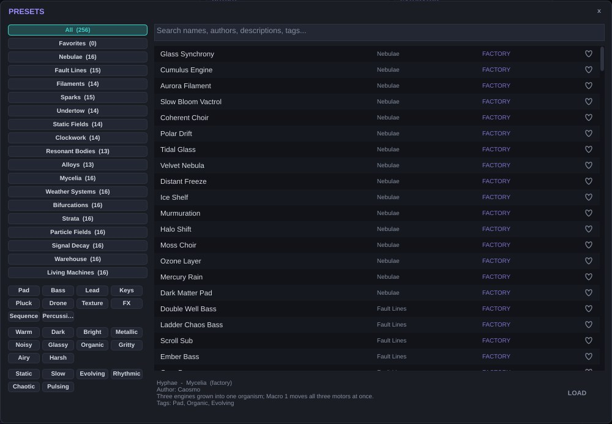
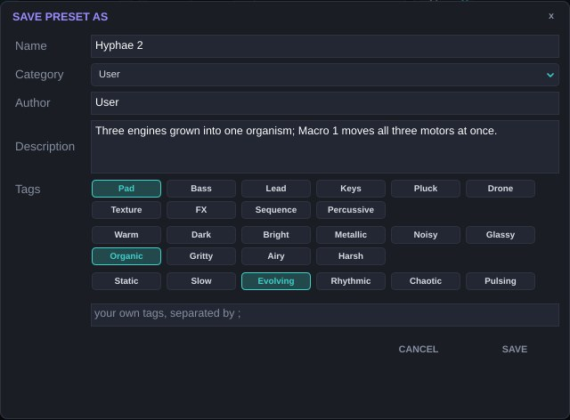

# Presets {#presets}

## El navegador {#presets-navegador}

Clic en el nombre del preset o en **BROWSE**. El navegador combina cuatro filtros:

- **Categoría**: *All*, *Favorites*, las 17 categorías de fábrica y las de tus presets, con el número de presets de cada una.
- **Favoritos**: el corazón junto a cada preset.
- **Etiquetas** en tres familias, que se combinan en modo AND (un preset debe tener todas las que marques):
  - **Type**: Pad, Bass, Lead, Keys, Pluck, Drone, Texture, FX, Sequence, Percussive.
  - **Character**: Warm, Dark, Bright, Metallic, Noisy, Glassy, Organic, Gritty, Airy, Harsh.
  - **Motion**: Static, Slow, Evolving, Rhythmic, Chaotic, Pulsing.
- **Búsqueda** por texto en nombre, autor, descripción y etiquetas.

Al seleccionar un preset, la parte inferior muestra su categoría, autor, descripción y etiquetas. **LOAD** lo carga.

Las flechas de la barra superior recorren la lista filtrada.

## Guardar {#presets-guardar}

**SAVE AS** pide nombre, categoría, autor, descripción y etiquetas, más etiquetas propias separadas por punto y coma. **SAVE** sobrescribe el preset de usuario actual. Caosmo **sugiere etiquetas de carácter** según los motores de las capas activas (por ejemplo Glassy y Airy para Kuramoto, Metallic y Bright para Circle Map). Añade Type y Motion y revísalas antes de guardar. Los presets de usuario se guardan como `.caosmo` en `Documentos/Caosmo Presets/User`. Clic derecho sobre un preset de usuario para editar su información, renombrarlo o borrarlo.

Un preset guarda todos los parámetros, las rutas (incluidas las creadas con MIDI Learn), las cuatro formas VENV, la curva de keytrack y los snapshots de EQ. No guarda las preferencias de interfaz. *Settings → OPEN PRESETS FOLDER* abre la carpeta de presets.

## Las 20 categorías {#presets-categorias}

| Categoría | Presets | Qué encontrarás |
| --- | --- | --- |
| Nebulae | 16 | Pads amplios y evolutivos. |
| Fault Lines | 15 | Bajos: pozos dobles, escaleras saturadas, sub-espirales. |
| Filaments | 14 | Leads y melodías. |
| Sparks | 15 | Plucks, mazos, percusión. |
| Undertow | 14 | Drones profundos. |
| Static Fields | 14 | Ruidos, texturas, efectos. |
| Clockwork | 14 | Secuencias, arpegios y pulsos sincronizados. |
| Resonant Bodies | 13 | Cuerdas, campanas y cuerpos físicos. |
| Alloys | 13 | Combinaciones de varios motores. |
| Mycelia | 16 | Tres motores que se comportan como un organismo; Macro 1 mueve los tres a la vez. |
| Weather Systems | 16 | Atractores que se modulan entre sí: cambios lentos de «tiempo atmosférico». |
| Bifurcations | 16 | Una VENV lleva un parámetro de caos del orden a la turbulencia; el aftertouch empuja más allá. |
| Strata | 16 | Drones graves en los que el keytrack vuelve inestables las notas agudas. |
| Particle Fields | 16 | Nubes de grano con Loop Lock: azar que se repite. |
| Signal Decay | 16 | Bucles inestables, frequency shifter realimentado, degradación. |
| Warehouse | 16 | Texturas de techno: LFOs enlazados, *gates* sincronizados, stutter. |
| Living Machines | 16 | Dieciséis moduladores conectados entre sí: sistemas que se autoorganizan. |
| Stochastic | 12 | Gendy, Noise y disparos aleatorios: Xenakis, lluvia de Poisson, relojes humanos, secuencias a cara o cruz. |
| Neurons & Maps | 12 | Los mapas de SuperCollider afinados y los modelos de Ecosystems: neuronas, relojes químicos, presas y depredadores. |
| Bouncing Bodies | 8 | Membrane: pelotas que rebotan sobre tambores, barras y campanas. |

El listado completo está en el apéndice.

## Cómo se hicieron {#presets-como}

Los presets se describen en archivos de texto y un programa los genera, los renderiza y los mide. Cada preset se **nivela automáticamente** a unos −18 dBFS RMS y se comprueba que su pico verdadero no supere −0,8 dBTP; además se mide cuánto evoluciona el sonido en el tiempo, para que los marcados como *Evolving* o *Chaotic* lo sean realmente. Por eso puedes recorrer el banco sin sobresaltos de volumen.

# Tutoriales {#tutoriales}

Cada receta parte del patch inicial: *Settings → RESET TO INIT*. Los valores son puntos de partida: escucha y corrige.

## Un pad que se sincroniza {#tut-pad}

1. L1 Engine **Kuramoto**. Ratio **Harmonic**, Spread **0,6**, N Osc **8**, Out **Coherent**.
2. ENV GEN: Attack **1,5 s**, Release **3 s**.
3. FILTER: LPF 24 dB, Cutoff **3 kHz**, Res **20 %**.
4. MODULATORS: LFO 1 en **Random Smooth**, Rate **0,08 Hz**. ASSIGN → clic en **K** (en MAIN). En la matriz, Amount **0,35**.
5. Sube K hasta oír que el sonido entra y sale del bloqueo.
6. Envío FX1 a **−8 dB** (Reverb del bus A).

Para más vida: Drift Pitch **Subtle** y, en L2, el mismo motor con Ratio **Golden** y Level **−9 dB**.

## Un bajo de doble pozo con mordida {#tut-bajo}

1. L1 **Duffing**: Gamma **0,28**, Delta **0,18**, Omega **1**, Out **Position**.
2. Voices **1**, Legato **On**, Glide **40 ms**.
3. FILTER: **Ladder**, Cutoff **400 Hz**, Res **35 %**, LPG **Amp + Filt**.
4. ENV GEN: Attack **2 ms**, Decay **350 ms**, Sustain **40 %**.
5. Matriz: *Velocity → L1 Motor 1* (Gamma), Amount **0,3**, Curve **Exp**. Tocar fuerte hace saltar la masa entre pozos.
6. OUTPUT: Drive **25 %** Tape, Bass Mono **120 Hz**.

## Percusión de arena y metal {#tut-perc}

1. L1 **Logistic/Henon**: Morph **0,3**, Smooth **0,55**.
2. ENV GEN: ADSR **One-Shot**, Attack **0,3 ms**, Decay **90 ms**, Sustain **0**.
3. FILTER: **BPF**, Res **60 %**. Matriz: *Keytrack → L1 Cutoff*, Amount **0,5**.
4. L2 **Chua** Alpha **10,5**, misma envolvente con Decay **40 ms**, Level **−6 dB**: el «golpe».
5. Matriz: *Note Random → L1 Cutoff*, Amount **0,08**: cada golpe suena distinto.

## Una nube que se reescribe {#tut-nube}

1. L1 **Wave Grains**: Size **60 ms**, Count **10**, Scatter **0,7**, Spray **0,9**, Jitter **0,2**.
2. Chaos **Rossler**, Chaos Rate **0,3 Hz**, Chaos>X **0,6**, Chaos>Y **0,5**, Chaos>Fold **0,3**, Tau **0,6**. Grain **Frozen**.
3. ENV GEN: Vactrol con Rise Slow **800 ms** y Fall Slow **4 s**.
4. LFO 2 en Random S&H, Sync Host **1/8**, hacia *L1 Motor 5* (Size ms) con Amount **0,25**. Activa **Loop Lock** con Division **2 bars**: el tamaño de grano cambia siempre igual, como una secuencia.
5. En MASTER → FX, pon la ranura 2 del bus B en **Granular** con Option **Freeze**, y sube el envío FX2 de la capa a **−12 dB**.

## Un cello expresivo con MPE {#tut-cello}

1. Settings: MPE **Lower**, MPE PB Range **48** (o lo que use tu controlador).
2. L1 **Bowed String**: Press **0,5**, Speed **0,5**, Pos **0,18**, Body **0,6**, Rasp **0,15**.
3. ENV GEN: **Vactrol**, Rise Fast **20 ms**, Fall Slow **1,2 s**.
4. Matriz: *MPE Pressure → L1 Motor 2* (Speed) Amount **0,5**; *MPE Pressure → L1 Motor 1* (Press) Amount **0,25**; *MPE Slide → L1 Motor 3* (Pos) Amount **0,3**.
5. LFO 1 **Poly**, Sine **5,5 Hz**, hacia *L1 Fine* Amount **0,08**, con **Fade In 600 ms**: vibrato que llega tarde, como un intérprete.

## Un drone de techno con el Deluge {#tut-techno}

1. L1 **Mackey-Glass**: Sharp **0,45**, Crackle **0,1**, Octave **Fixed**. L2 **Gray-Scott** con BPF **0,6**.
2. LFO 1 Sync Host **1/16**, Pulse, hacia *L1 Level* y *L2 Level* (Amount negativo, −0,6): *gate* rítmico. Link **Dual** con Link Mode **Divide**: LFO 2 a la mitad, hacia L2 Cutoff.
3. MASTER → DELUGE: Deluge FX **On**; Mod FX **Dimension** (Depth 20); Delay Amount **18**, Sync **1/8**, Dotted, Analog **On**; Reverb **Mutable** Amount **15**; Compressor Threshold **20**, Blend **35**.
4. En REAPER, automatiza **Deluge Stutter** en el último pulso de cada cuatro compases.

## Escribir una bifurcación {#tut-bifurcacion}

1. L1 **Sprott**: Chaos **0,1**, Damp **1**, Out **X**.
2. VENV 1: dibuja una rampa lenta de 0 a 1 con una meseta al final. Mode **1-Shot**, Time **12 s**, Voicing **Poly**.
3. Matriz: *VENV 1 → L1 Motor 1* (Chaos), Amount **0,7**.
4. Mantén una nota: el tono se desdobla en suboctavas y acaba en turbulencia. *Aftertouch → L1 Motor 1* con Amount **0,2** te deja empujarlo en directo.

## Lluvia afinada con disparos de Poisson {#tut-lluvia}

1. L1 **Noise**: Type **Dust2**, Density **200**, Key BPF **0,8**, Q **18**.
2. ENV GEN: Attack **5 ms**, Release **1 s**. FILTER: **Ladder**, Cutoff **2 kHz**, Res **40 %**.
3. MODULATORS → TRIGGER 1: Mode **Dust**, Rate **6 Hz**, Output **S&H Decay**, Length **150 ms**, Dist **Beta**.
4. Matriz: *Trig 1 → L1 Cutoff*, Amount **0,4**, y *Trig 1 → L1 Motor 5* (Q), Amount **0,2**.
5. *Macro 1 → Trig1 Prob*: con la macro cierras o abres la lluvia. Para que cada nota tenga otro carácter, *Note Random → L1 Motor 2* con Note Random Dist en **Gauss**.

# Rendimiento y CPU {#rendimiento}

El coste depende de **voces × capas × motor**. Algunas pautas:

- Los motores más ligeros son Maps, Noise, Logistic/Henon, Duffing, Sprott, Chua y Circle Map. Los más pesados, Lorenz Additive (con Engine HQ), Wave Grains con Count alto, Kuramoto con 12 osciladores y Gray-Scott.
- **Sub 1** duplica el coste del motor de esa capa; **Sub 2** es gratis.
- Los moduladores **Poly** cuestan una instancia por voz.
- Baja **Voices** a lo que necesitas: 8 suele bastar para pads, 1–4 para bajos y leads.
- Apaga **Engine HQ** si no usas Lorenz Additive o si vas justo de CPU.
- Apaga con **PWR** las capas que no usas (Mute no ahorra CPU).
- Los visualizadores solo consumen CPU con la ventana abierta; ciérrala o páusalos en Settings.
- En el DAW, usa *render/freeze* de pista para mezclas grandes.

# Solución de problemas {#problemas}

| Síntoma | Causa probable y solución |
| --- | --- |
| No suena nada | ¿La capa tiene motor y PWR encendido? ¿El canal MIDI de la capa coincide? ¿Gray-Scott con Drift 0 se ha extinguido? ¿Bowed String con Press o Speed a 0? |
| Suena, pero sin altura | El motor no tiene altura (Lorenz+Rossler, Logistic/Henon, Gray-Scott sin BPF). Sube Sub 2 o usa un filtro Comb/BPF con keytrack. |
| La nota salta de octava | Mackey-Glass en Octave Free o Sprott/Chua en zona de duplicación de periodo. Usa Octave Fixed o baja el parámetro de caos. |
| Clics al tocar rápido | Attack muy corto con un motor que arranca con mucha energía. Sube Attack a 2–5 ms o usa Vactrol. |
| Nivel que salta | Un sistema cruzando al caos. Activa el limitador master o baja el parámetro de caos. |
| El plugin no aparece (macOS) | Gatekeeper: ejecuta `xattr -dr com.apple.quarantine` sobre `Caosmo.vst3`. |
| El plugin no aparece (Windows) | La carpeta `Common Files\VST3` no está en las rutas del DAW, o se copió sin permisos. |
| Lento con muchas voces | Ver el capítulo de rendimiento. |
| MPE no responde | MPE Mode activado, zona correcta (Lower/Upper) y pista del DAW recibiendo todos los canales. |
| Una ruta no hace nada | Mira su luz en la matriz: roja (fuente por nota a destino global) o ámbar (parámetro de motor inexistente). |
| El stutter no se oye | Deluge FX **On**. Stutter repite lo que acaba de sonar: actívalo con audio sonando. |

# Cómo se hizo {#comosehizo}

Caosmo se construyó en cinco versiones, de un núcleo que se podía tocar a un instrumento completo con efectos y binarios para tres sistemas.

## Investigación {#hizo-investigacion}

El punto de partida fue la documentación pública de Fragua: su arquitectura de tres capas, la lista de motores, la descripción de cada control y las demostraciones publicadas. A partir de ahí cada sistema se reimplementó desde sus ecuaciones originales en la literatura científica (Kuramoto, Duffing, Sprott, Lorenz, Rössler, May, Hénon, Chua, Gray-Scott, Mackey-Glass, Arnold), sin acceso al código de Fragua.

## Arquitectura del código {#hizo-arquitectura}

- **Lenguaje y framework**: C++ sobre JUCE 8.0.4, compilado con CMake.
- **Parámetros**: un único árbol de estado con más de mil parámetros automatizables. Los de los diecisiete motores existen siempre en cada capa, por eso cambiar de motor no pierde ajustes.
- **Motores**: cada sistema se integra por muestra, la mayoría con Runge-Kutta de cuarto orden. Los motores con altura escalan su paso de integración con la frecuencia de la nota, con un tope para seguir estables en los agudos; algunos (Sprott, Chua) se calibraron midiendo su periodo real con el banco de pruebas para que la nota caiga donde debe. Mackey-Glass incluye un detector de periodo que corrige el retardo en tiempo real.
- **Protección numérica**: cada motor comprueba su estado en cada muestra y se reinicia si una variable se dispara.
- **Modulación**: se calcula en bloques cortos. Las fuentes por nota viven dentro de cada voz; las globales se comparten. La matriz decide en cada bloque qué rutas son aplicables a cada destino.
- **Interfaz**: dibujada con JUCE y un estilo propio; los halos de modulación leen el valor modulado real desde el hilo de audio sin bloquearlo.

## El port del Deluge {#hizo-deluge}

Los efectos del rack DELUGE FX se copiaron del repositorio del firmware comunitario del Deluge. 31 archivos son idénticos byte a byte al original. Para compilarlos fuera del hardware se escribieron pequeños sustitutos de las cabeceras del firmware (memoria, parámetros, tablas) y una versión portátil de la librería vectorial Argon. Solo un archivo del firmware se modificó: el procesador de respuesta al impulso del delay analógico, para usar en ordenadores su ruta escalar, que el propio firmware documenta como equivalente.

El audio se convierte al punto fijo de 32 bits del Deluge, se procesa en bloques de 64 muestras con las mismas conversiones de parámetros que los menús del aparato, y vuelve a coma flotante. Como el Deluge trabaja a 44,1 kHz, las velocidades de los efectos se reescalan a la frecuencia del host para que los tiempos coincidan en milisegundos. Una ganancia fija de −12,96 dB compensa la etapa de salida del Deluge, de modo que el rack en neutro no cambia el nivel.

## Presets {#hizo-presets}

Los 288 presets se escriben como texto: cada línea fija los parámetros que difieren del patch inicial. Un generador los carga en el motor real, los renderiza, mide su nivel RMS y su pico verdadero, los nivela, comprueba la evolución temporal y los empaqueta dentro del plugin. Los 128 presets experimentales y los 32 de la versión 0.5 los generan scripts que combina reglas de diseño por categoría (qué motores, qué moduladores conectados entre sí, qué macros).

## Pruebas {#hizo-pruebas}

- Un banco de pruebas propio con modos para estabilidad de los motores, barridos de parámetros, uso de CPU, carga de todos los presets, interfaz y ganancia del rack Deluge.
- Compilaciones con AddressSanitizer y UndefinedBehaviorSanitizer sin errores.
- **pluginval** (Tracktion) en nivel 7, incluida su prueba de seguridad entre hilos, que destapó y permitió corregir un fallo del Mod FX en la versión 0.4.
- Integración continua en GitHub Actions: cada cambio se compila para Linux, Windows y macOS, se valida con pluginval y se empaqueta.

# Glosario {#glosario}

| Término | Significado |
| --- | --- |
| Atractor | Región hacia la que evoluciona un sistema dinámico con rozamiento. |
| Atractor extraño | Atractor con estructura fractal sobre el que el movimiento nunca se repite. |
| Bifurcación | Cambio cualitativo del comportamiento al variar un parámetro. |
| Duplicación de periodo | Bifurcación en la que el ciclo tarda el doble en repetirse: aparece la suboctava. |
| Histéresis | El sistema depende de su historia: subir y bajar un control no recorre los mismos estados. |
| Lenguas de Arnold | Zonas de parámetros donde dos osciladores se enganchan en una razón racional. |
| LPG | *Low pass gate*: compuerta que abre a la vez volumen y brillo, típica de Buchla. |
| Mapa | Sistema de tiempo discreto: calcula el siguiente estado a partir del actual. |
| MPE | *MIDI Polyphonic Expression*: cada nota en su propio canal, con bend, presión y slide propios. |
| Poly / Global | Modulador con una copia por nota / una única copia compartida. |
| Retrato de fase | Gráfico de una variable frente a otra: muestra la forma del atractor. |
| Runge-Kutta 4 | Método numérico de cuarto orden para integrar ecuaciones diferenciales. |
| Semilla | Número que inicializa el generador aleatorio de cada nota. |
| True peak | Pico real de la señal analógica reconstruida, que puede superar el de las muestras. |
| Vactrol | Optoacoplador de lámpara y fotorresistencia, con respuesta lenta y memoria. |

# Apéndices {#apendices}

## Catálogo de presets {#ap-catalogo}

PRESETLIST

## Nombres de parámetros en el DAW {#ap-ids}

Todos los parámetros son automatizables. En el DAW aparecen con un prefijo que indica su lugar:

| Prefijo | Ejemplo | Bloque |
| --- | --- | --- |
| L1, L2, L3 | L2 Cutoff, L1 Kuramoto K | Capas y sus motores |
| LFO1–8 | LFO3 Rate | LFOs |
| VENV1–4 | VENV1 Time | Envolventes dibujables |
| Attr1–4 | Attr2 P1 | Atractores |
| Trig1–4 | Trig3 Rate | Disparos aleatorios |
| Slot1–24 | Slot5 Amount | Rutas de la matriz |
| Master / Comp / Sat / Limiter | Comp Thresh | Cadena master |
| FX A/B/C | FX B Slot2 P1 | Buses de efectos |
| Deluge | Deluge Delay Amount | Rack DELUGE FX |
| (sin prefijo) | Macro 1, Voices, Glide | Globales |

Para automatizar el sonido sin tocar presets, usa las **macros**: tienen nombres estables y cada preset las asigna a lo esencial.

## Historial de versiones {#ap-historial}

| Versión | Cambios |
| --- | --- |
| 0.1 | Núcleo jugable: 3 capas, 12 motores, filtro, envolvente, LFOs, matriz e interfaz genérica. |
| 0.2 | Vactrol y VENV, atractores, enlaces de LFO y Loop Lock, EQ con snapshots, cadena master, buses FX, navegador con etiquetas, 128 presets. |
| 0.3 | 128 presets experimentales y evolutivos. |
| 0.4 | Rack DELUGE FX, licencia GPL v3, Windows y macOS, latencia constante, manual completo. |
| 0.5 | Generadores de SuperCollider: motores Gendy, Maps, Ecosystems, Noise y Membrane; disparos aleatorios; distribuciones; ondas de LFO con memoria; filtros Friction y Spring; siete atractores; seis efectos espectrales y de ciclo; 32 presets. |

## Licencia {#ap-licencia}

Caosmo es software libre: puedes usarlo, estudiarlo, modificarlo y redistribuirlo bajo la **GNU General Public License versión 3 o posterior**. Es obligatorio porque incluye código GPL-3.0 del firmware del Synthstrom Audible Deluge. Si distribuyes binarios, debes ofrecer también el código fuente completo bajo la misma licencia. JUCE 8 se usa bajo su opción AGPLv3, compatible con la GPLv3 por la sección 13 de ambas licencias. El texto completo de la licencia va en el archivo `LICENSE` de cada paquete.

## Créditos {#ap-creditos}

| Parte | Autoría y licencia |
| --- | --- |
| Caosmo | Eloy Platas, GPL v3 o posterior. |
| Concepto de referencia | Fragua, de Pura Belia (purabelia.com). Caosmo es una obra independiente. |
| DELUGE FX | Firmware comunitario del Synthstrom Audible Deluge, © Synthstrom Audible Limited y colaboradores, GPL v3. |
| Reverb Mutable | Basada en código de Emilie Gillet (Mutable Instruments), licencia MIT. |
| Freeverb | Jezar at Dreampoint, dominio público. |
| Framework | JUCE 8.0.4, AGPLv3. |
| Validación | pluginval, de Tracktion. |
| Generadores de la 0.5 | Reimplementados a partir de SuperCollider (GPL v2 o posterior): Gendy1 (Nick Collins, a partir de Iannis Xenakis), los ChaosGen y PV_ del núcleo, SLUGens (Nick Collins), MCLDUGens (Dan Stowell: Friction, TBall, WaveLoss, Squiz), ChaosUGens (Till Bovermann) y BhobUGens (GaussTrig, LorenzTrig). |
| Sistemas dinámicos | Kuramoto (1975), Duffing (1918), Sprott (1997), Lorenz (1963), Rössler (1976), May (1976), Hénon (1976), Chua (1983), Gray y Scott (1983), Mackey y Glass (1977), Arnold (1961), Xenakis (1991), Pickover (1994), Chirikov (1979), Devaney (1984), FitzHugh (1961) y Nagumo (1962), Prigogine y Lefever (1968), Field y Noyes (1974), Lotka (1925) y Volterra (1926), Arneodo, Coullet y Tresser (1981), Ludwig, Jones y Holling (1978). |
